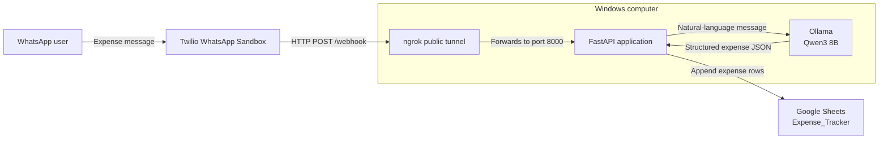

# WhatsApp AI Expense Tracker

A Windows-first personal expense tracker. Send a natural-language WhatsApp message, and the application uses a local Qwen3 model through Ollama to extract expenses and append them to a Google Sheet.

> This project does **not** use MCP. Its current flow is: WhatsApp → Twilio → FastAPI → Ollama/Qwen3 → Google Sheets.

## Architecture



All components in the **Windows computer** section run locally. Twilio and Google Sheets are cloud services; ngrok makes the local FastAPI webhook reachable by Twilio during development.

## What it does

For a message such as:

```text
I spent Rs 200 on lunch today and Rs 23 on the bus.
```

the application extracts one record for each expense and writes rows like these to Google Sheets:

| Date | Category | Event | Price |
| --- | --- | --- | --- |
| 2026-08-23 | Food | Lunch | 200 |
| 2026-08-23 | Transport | Bus | 23 |

## Prerequisites

- Windows 10 or 11
- Python 3.11 or newer
- [Ollama](https://ollama.com/) with the `qwen3:8b` model
- An ngrok account and the ngrok Windows client
- A Twilio account with access to the WhatsApp Sandbox
- A Google account for a Google Cloud service account and Google Sheet

## 1. Clone and install Python dependencies

Open PowerShell and run:

```powershell
git clone https://github.com/Abijith97/expense-tracker-with-mcp.git
cd expense-tracker-with-mcp
py -m venv .venv
.\.venv\Scripts\Activate.ps1
python -m pip install --upgrade pip
pip install -r requirements.txt
```

If PowerShell blocks activation, run this for the current PowerShell session and then activate the environment again:

```powershell
Set-ExecutionPolicy -Scope Process -ExecutionPolicy Bypass
```

## 2. Install and run Ollama

Install Ollama for Windows from [ollama.com](https://ollama.com/), then download the model:

```powershell
ollama pull qwen3:8b
```

Ollama normally starts automatically on Windows. To verify that it is available, run:

```powershell
ollama list
```

The app connects to Ollama at `http://127.0.0.1:11434` by default. You can override this, for example when using another machine, before starting the app:

```powershell
$env:OLLAMA_HOST = "http://192.168.1.10:11434"
```

## 3. Set up Google Sheets

1. Create a Google Sheet named `Expense_Tracker`.
2. Put these headers in the first row: `Date`, `Category`, `Event`, `Price`.
3. In Google Cloud Console, create a project and enable the **Google Sheets API** and **Google Drive API**.
4. Create a service account and download its JSON key.
5. Rename the downloaded file to `service-account.json` and place it in this project folder.
6. Share the Google Sheet with the service account email address as an **Editor**.

`service-account.json` is intentionally ignored by Git. Do not commit or share it.

If your spreadsheet has a different name, set it before launching the app:

```powershell
$env:SPREADSHEET_NAME = "My Expense Sheet"
```

## 4. Run the local web server

In PowerShell, from the project folder with the virtual environment activated:

```powershell
uvicorn main:app --reload --host 127.0.0.1 --port 8000
```

Leave this terminal running. FastAPI is now listening at `http://127.0.0.1:8000`.

## 5. Expose the local server with ngrok

In a second PowerShell window, authenticate ngrok once using the token from your ngrok dashboard:

```powershell
ngrok config add-authtoken YOUR_NGROK_TOKEN
```

Then start a tunnel to the FastAPI server:

```powershell
ngrok http 8000
```

Copy the HTTPS forwarding address, for example:

```text
https://example-1234.ngrok-free.app
```

ngrok's free URL changes whenever you start a new tunnel. It is suitable for development only.

## 6. Configure Twilio WhatsApp Sandbox

1. Sign in to the [Twilio Console](https://console.twilio.com/).
2. Open **Try WhatsApp** and activate the WhatsApp Sandbox if prompted.
3. On your phone, send `join <your sandbox code>` to the Sandbox WhatsApp number, or scan the displayed QR code. Twilio will confirm that your phone has joined the Sandbox.
4. In **Sandbox settings**, find **When a message comes in**.
5. Enter your ngrok HTTPS address with `/webhook` appended, for example:

   ```text
   https://example-1234.ngrok-free.app/webhook
   ```

6. Select **HTTP POST** and save the settings.

The Sandbox only accepts messages from phone numbers that have joined it. Each tester must join with the current Sandbox code. See Twilio's [WhatsApp quickstart](https://www.twilio.com/docs/whatsapp/quickstart) for the current Console flow.

## 7. Test the complete flow

Send a WhatsApp message from the phone that joined the Sandbox:

```text
I spent Rs 200 on lunch today and Rs 23 on the bus.
```

You should see the incoming message, LLM response, and added rows in the FastAPI terminal. Open the Google Sheet to confirm the two rows were added.

## Troubleshooting

| Symptom | Check |
| --- | --- |
| `ModuleNotFoundError` | Activate `.venv` and run `pip install -r requirements.txt`. |
| Ollama connection error | Run `ollama list`; confirm the model is installed and Ollama is running. |
| Google authentication error | Check that `service-account.json` is in the project folder and that the sheet is shared with the service account email. |
| Twilio does not reach the app | Keep both FastAPI and ngrok running, then update the Twilio webhook after every new ngrok URL. |
| No rows appear in Sheets | Review the FastAPI terminal for the extracted JSON or an API error. |

## Security notes

- Never commit `service-account.json` or other credentials.
- ngrok publicly exposes your local server while it runs; use it only for development.
- The current application stores every successfully extracted message as new rows. It does not yet include duplicate-webhook protection or automatic WhatsApp confirmations.
