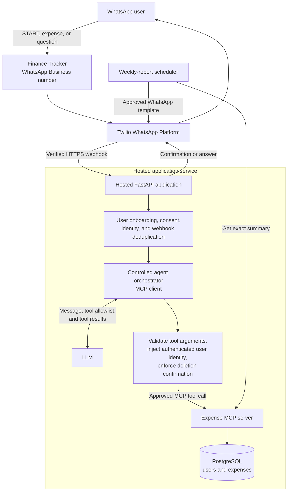

# WhatsApp AI Expense Tracker

## End goal architecture

The end product is a hosted, multi-user WhatsApp finance tracker. Users message one WhatsApp Business number, receive a private account associated with their phone number, record expenses in natural language, and ask questions such as “How much did I spend on food last week?”



### MCP client and server roles

The hosted FastAPI application is the **MCP host**. Its conversation orchestrator acts as an **MCP client**: it interprets a WhatsApp message with the LLM, chooses the appropriate tool, and sends the tool result back to the user in a clear response. The **Expense MCP server** owns the finance operations and is the only component that reads or changes the expense database.

### Controlled AI-agent orchestration

The current POC uses a small, controlled AI-agent-style loop rather than relying on keyword commands. For each message, Ollama/Qwen selects one MCP action from an allowlist, FastAPI validates its arguments and adds the authenticated WhatsApp number, then the Expense MCP server performs the database operation. The agent may make at most three tool calls before it must reply.

```mermaid
sequenceDiagram
    participant U as WhatsApp user
    participant A as FastAPI agent orchestrator
    participant L as Ollama/Qwen
    participant M as Expense MCP server
    participant D as SQLite database

    U->>A: "How do I use this finance tracker?"
    A->>L: Message + allowed tool schemas + current date
    L-->>A: get_help({})
    Note over A: Validates action; app owns user identity
    A->>M: MCP get_help
    M-->>A: Help and examples
    A->>L: Tool result
    L-->>A: Friendly reply
    A-->>U: Help response

    Note over A,L: Maximum three MCP calls per message
    Note over A,M: The model cannot confirm a deletion
```

This is deliberately bounded: the LLM cannot supply another user's identity, invent financial results, or confirm a deletion. Exact `CONFIRM DELETE <id>` is handled by FastAPI, not the model. The MCP server validates every request and the database remains the source of truth for balances and summaries.

| User request | MCP operation | Result |
| --- | --- | --- |
| `HELP` or first message | `get_help` | Explains what the tracker can do and gives examples. |
| “Lunch ₹120 today” | `record_expense` | Validates and records an expense for that user. |
| “What did I spend this week?” | `get_summary(period)` | Returns an exact daily, weekly, monthly, or yearly summary. |
| “Show my lunch expense from yesterday” | `find_expenses` / `get_expense` | Finds a specific expense owned by that user. |
| “Delete the grocery expense from yesterday” | `find_expenses` then `delete_expense` | Shows the matching expense and requires confirmation before deletion. |

Each MCP operation receives the authenticated user identity from the application. The database—not the LLM—calculates totals and comparisons, while the LLM handles natural-language understanding and friendly responses.

### First-time and help experience

On a first message, the application creates the user's private account and explains that they can send `HELP` at any time:

```text
Finance Tracker: Welcome! I can record expenses and answer questions about your spending.
Send HELP to see examples, or try: “Lunch ₹120 today”.
```

`HELP` will include examples for adding expenses, requesting daily/weekly/monthly/yearly summaries, finding a specific expense, and deleting an expense safely.

## Example user journey

The user needs only WhatsApp; they do not install the application or configure Twilio.

```text
User: START

Finance Tracker: Welcome. Reply YES to create your private tracker.

User: YES

Finance Tracker: Which currency do you use?

User: INR

Finance Tracker: Your tracker is ready. Try: “Lunch ₹120 today”.

User: Paid ₹850 for groceries yesterday

Finance Tracker: Added: Groceries — ₹850 on 25 Aug 2026.

User: Compare this week with last week

Finance Tracker: This week: ₹4,250. Last week: ₹3,100.
Increase: ₹1,150 (37%). Largest increase: Food (+₹720).
```

The user can later ask for summaries in natural language and manage their account through commands such as `PROFILE`, `EXPORT`, `DELETE MY DATA`, and `STOP`.
