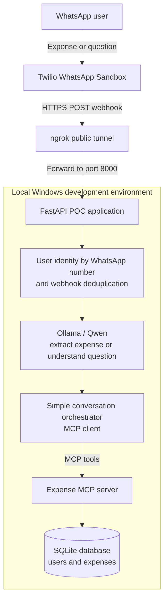

# WhatsApp AI Expense Tracker

## End goal architecture

This proof of concept is a multi-user WhatsApp finance tracker. A user is identified by their WhatsApp number, logs expenses in natural language, and asks simple questions such as “How much did I spend on food last week?” It remains a local development project; production hosting, scheduled reports, dashboards, billing, and enterprise onboarding are out of scope for now.

The MCP server exposes focused operations such as `record_expense`, `get_weekly_summary`, `compare_weeks`, and `get_category_trend`. The database—not the LLM—calculates totals and comparisons.
