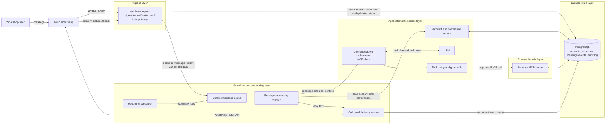
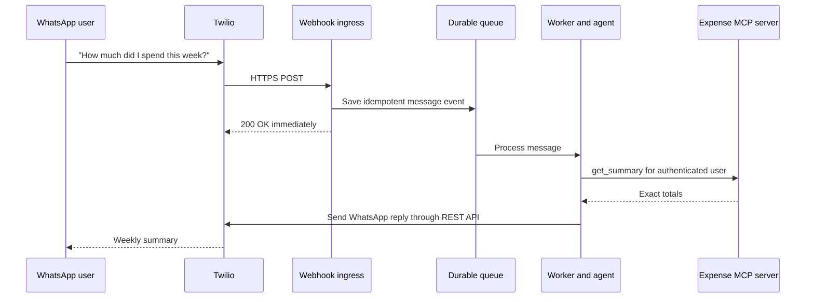

# WhatsApp AI Expense Tracker

## Goal architecture

The goal is a reliable, multi-user WhatsApp finance tracker. A user messages one WhatsApp Business number to record expenses or ask questions. The system processes each message privately, uses MCP tools for finance operations, and sends a reply back to WhatsApp.

The POC currently runs locally with FastAPI, Ollama/Qwen, an in-process MCP server, SQLite, Twilio, and ngrok. The diagram below is the target production architecture: the same responsibilities, separated into dependable system functions.

## System functions

These are layers, not a numbered execution order. The **durable state layer** supports several functions at once; it does not come after them.

| Layer | System function | Uses | Owns |
| --- | --- | --- | --- |
| Channel | **Twilio WhatsApp** | WhatsApp Business platform | Receiving user messages and delivering replies. |
| Ingress | **Webhook ingress** | Twilio and durable state | Signature verification, message parsing, idempotency, inbound-event storage, and a fast `2xx` response. |
| Durable state | **PostgreSQL** | - | Accounts, preferences, expenses, inbound events, outbound-delivery status, and audit records. |
| Processing | **Durable queue** | Ingress and scheduler | Reliable handoff of inbound messages and scheduled jobs to workers. |
| Processing | **Worker** | Queue, account service, agent, and delivery service | Retries, time limits, and execution of work outside the inbound webhook. |
| Intelligence | **Account and preference service** | PostgreSQL | The private user context: identity, currency, timezone, consent, and account state. |
| Intelligence | **Controlled agent orchestrator** | Worker, LLM, policy, and MCP client | Choosing allowlisted tools and composing a response. |
| Intelligence | **Tool policy and guardrails** | Account context and agent action | Injecting user identity, validating arguments, and enforcing confirmation before deletion. |
| Domain | **Expense MCP server** | Guardrails and PostgreSQL | The finance operations: record, find, retrieve, summarize, and delete expenses. |
| Delivery | **Outbound delivery service** | Worker, PostgreSQL, and Twilio credentials | Sending the final WhatsApp message through Twilio's REST API and recording the outcome. |
| Processing | **Reporting scheduler** | Queue and MCP server | Triggering weekly summaries, reminders, and approved template messages. |

## Why the queue is important

Twilio calls the inbound webhook synchronously and expects a quick response. LLM inference can take longer, so the webhook should only validate and enqueue the message. A worker performs the AI and MCP work afterwards, then sends the finished reply through Twilio's outbound API.

## Production upgrade order

1. Add asynchronous outbound delivery: queue the inbound event, return quickly, then use Twilio's REST API from a worker.
2. Move SQLite to PostgreSQL and add migrations, backups, encrypted secrets, and audit records.
3. Add Twilio signature verification, rate limiting, structured logs, metrics, alerts, and a dead-letter queue.
4. Host the API, worker, database, and queue in cloud infrastructure; remove ngrok from the production path.
5. Add onboarding, user settings, exports, account deletion, scheduled reports, and support/admin tooling.

## MCP boundary

FastAPI is the MCP host. The controlled agent is its MCP client. The Expense MCP server is the finance-domain boundary and is the only component allowed to read or change expense data. The LLM never directly queries the database, supplies another user's identity, or confirms a deletion.
