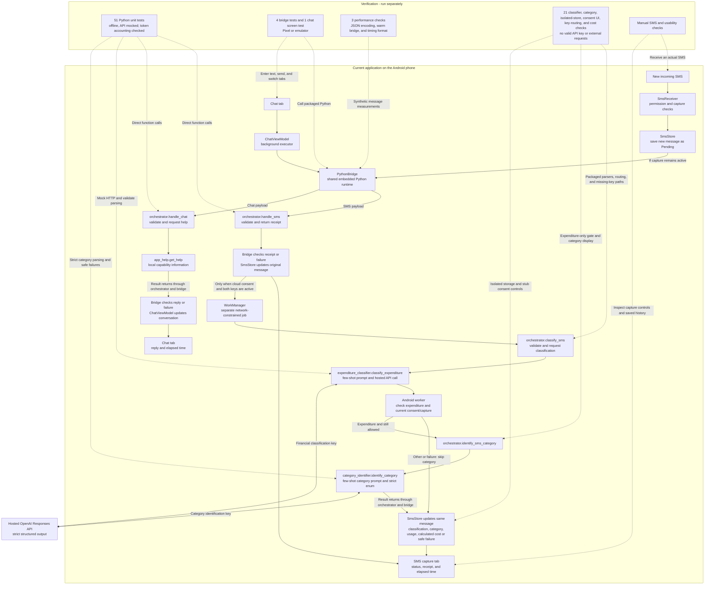
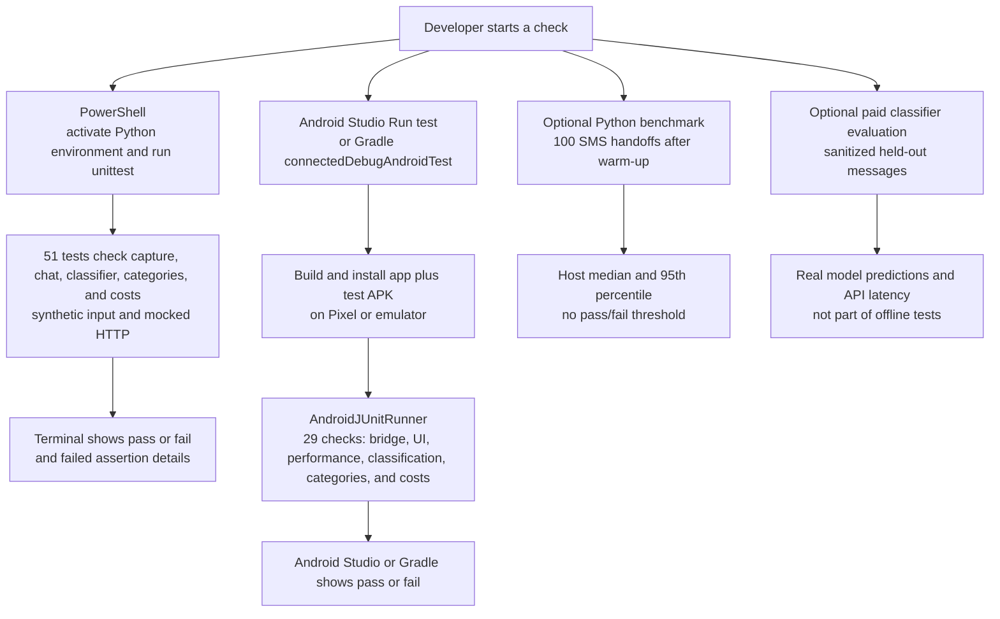
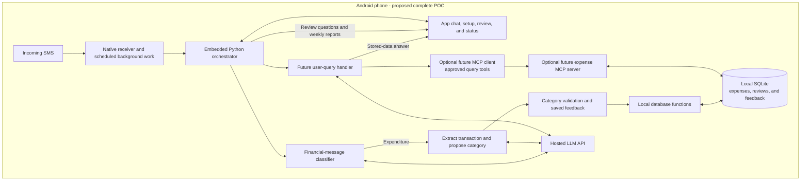

# Android AI Expense Tracker

An Android-only POC for learning LLM-powered workflows and orchestration, with MCP reserved for a possible future user chatbot. The application provides the chat interface and captures new SMS on the same phone.

**Available today:** the app has a Chat tab and an SMS capture tab. Chat calls a local help function through embedded Python and displays its reply. SMS capture saves the latest 20 incoming messages and displays Python's acknowledgement plus stage timings. Optional hosted classification calls the Python classifier directly to label messages **Expenditure** or **Other**, with separate inference timings. Expenditures then get a second hosted call to suggest a spending category or return **Not sure**, displayed on the same card. Cards also show reported token usage and calculated per-attempt USD costs when supported, alongside all existing bottleneck timings. App version: `0.8.0-message-costs`.

**Still planned:** transaction-detail extraction, expense storage, category confirmation/correction, and LLM chat answers. Every current chat message returns capability information; it does not yet interpret questions or record expenses.

Capture and built-in chat help work offline. Hosted classification needs internet, two dedicated API keys, and explicit upload consent. It needs no WhatsApp account, Twilio, ngrok, public webhook, or laptop service. Open the [Android project and setup guide](android-companion/README.md) to build, install, and run it.

For test locations, coverage, Windows commands, benchmarks, and manual checks, see the [Markdown testing wiki](docs/wiki/Testing.md).

## Progress — October 3, 2026

- SMS capture and the Kotlin-to-embedded-Python JSON handoff work on the Pixel 7a running Android 17. Real-message screenshots showed receiver entry to handoff result of **185.242 ms** when Python started and **7.548 ms** with Python already running. JSON encoding alone took **0.077 ms** and **0.027 ms**, respectively. These are two observations, not performance guarantees; they exclude SMS delivery and the later hosted classification.
- Hosted expenditure classification is implemented and installed. The user reports correct predictions for the messages tried on the phone. This verifies the live path for those samples, not a measured accuracy percentage or perfect classification for all messages.
- The few-shot prompt uses sanitized examples based on 25 outgoing-payment SMS and nine non-payment SMS, with additional synthetic counterexamples. This is prompting, not model training. Results and hosted-call latency appear separately from capture timings.
- On October 2, all **26 offline Python tests** and **14 Android checks** passed; debug APK builds and lint passed. Automated tests do not make paid API calls or establish model accuracy.
- On October 3, the unnecessary phone-side MCP layer was removed. All **27 offline Python tests** and **14 Android checks** passed; debug app/test APK builds and Android lint also passed. Version `0.6.0-direct-llm-classification` was installed on the Pixel over the existing app without clearing storage. Automated checks made no paid API calls; the updated live path still needs a synthetic SMS check.

**Scope decision:** sender/source validation and transaction ownership checks are deferred to avoid expanding the current POC. The classifier sees the SMS body, so a friend copying a bank alert can receive an Expenditure label. That label means the text describes an outgoing payment, not that the payment is verified as the user's. No source filter or ownership-confirmation feature has been added. Classification still does not insert an expense or affect spending totals.

Category identification is now implemented with starter categories and synthetic few-shot examples. Transaction-detail extraction, review, and a local expense database come next. Ownership validation can be revisited later.

## Design decision: direct functions now, MCP later

The current workflow already knows which helper to call, and the helpers run in the same embedded Python runtime. MCP initialization, discovery, JSON-RPC transport, and tool dispatch add no needed capability here, so the client/server, redundant tool wrapper, and MCP-only tests/compatibility script have been removed. Their earlier implementation remains in Git history.

The application is still **LLM-powered and orchestrated**. Python entry points validate inputs and call the inference helpers. The Android worker sequences expenditure checking and category identification, rechecking permission/capture/consent between calls. This remains a fixed workflow; neither LLM call chooses its own tools. Strict structured output, Python parsing, and Kotlin result checks enforce the output format independently of MCP. They do not guarantee the prediction is correct.

MCP can be reconsidered when the future chatbot selects reusable tools such as recording or querying expenses. It is not required for today's capture, help, or classification. No autonomous agent loop or model training has been added.

| Python module | Responsibility |
| --- | --- |
| `orchestrator.py` | Validate SMS/chat payloads, return local receipts, call classification/category/help directly, and preserve safe result contracts. |
| `expenditure_classifier.py` | Build the expenditure prompt and parse a strict boolean or raise a safe error. |
| `category_identifier.py` | Build a separate category prompt and return one allowed category or Not sure; failures are separate. |
| `category_examples.py` | Starter category vocabulary and synthetic labelled examples, not user-confirmed feedback or training. |
| `llm_usage.py` | Whitelist reported token counts and calculate supported standard-tier USD estimates without logging private data. |
| `llm_api.py` | Shared HTTPS transport and response-envelope parsing for both inference stages. |
| `classifier_examples.py` | Sanitized labelled examples used by the prompt and offline tests. |
| `app_help.py` | Local capability/setup text; no network, credentials, or expense writes. |

## Category identification: current milestone

The worker calls `orchestrator.classify_sms` first. If it returns Expenditure, and permission, capture generation, retained attempt, and cloud consent still allow processing, the worker calls `orchestrator.identify_sms_category`. Each entry point delegates directly to its Python helper. Other messages and expenditure failures skip categories.

Starter categories: **Transport, Groceries, Food & dining, Bills & utilities, Subscriptions, Shopping, Health, Education, Entertainment, Housing, Personal care, Other, Not sure**.

The category prompt and enum are in `category_identifier.py` and `category_examples.py`. These starter conventions need user-labelled examples before claiming accuracy: BMTC/metro → Transport, Blinkit without item detail → Groceries, explicit food delivery → Food & dining, Airtel recharge → Bills & utilities, ChatGPT subscription → Subscriptions. An explicit purchase purpose takes priority over the merchant; personal-name transfers, generic marketplaces without item detail, and mixed purchases should return **Not sure**. **Other** means a known purpose outside the named categories, not uncertainty.

The category request uses a strict enum schema and Python/Kotlin validation. This constrains the label format, not its correctness. [Official OpenAI structured-output documentation](https://developers.openai.com/api/docs/guides/structured-outputs).

Category failures are separate from expenditure classification. An expense-labelled message remains Expenditure even if the second request fails; no category is invented. Results are saved on the original captured-message card, not in an expense ledger. Older cards remain readable without a category, and updates do not upload them automatically. Manual reclassification repeats both stages for expenditures.

This adds a second API call/body upload, cost, and sequential latency for expenditures; Other messages use one call. Total analysis processing includes both stages; expenditure and category API timings are displayed separately. No human confirmation, transaction extraction, training, or expense insertion is included yet.

Verification for `0.8.0-message-costs`: **51 offline Python tests and 29 Android checks passed**; debug app/test APK builds and lint passed. The APK was installed on the Pixel 7a running Android 17 without clearing storage. No paid API calls were made; live category predictions still need a manual synthetic SMS check.

## Cost attribution: two dedicated API keys

Create two different OpenAI keys named `financial-classification` and `category-identification`, then enter them in their matching masked fields under SMS capture. Both are required with upload consent; using the same key twice is rejected. The expenditure bridge passes only the classification key, and the category bridge passes only the category key. Both stages keep the shared model setting and existing prompts. Capture and local chat use neither key.

Use each key exclusively for its matching functionality. OpenAI's Costs API supports `api_key_ids` filtering and `group_by=api_key_id` in daily buckets, so the provider-reported monetary totals can be attributed to each functionality. This is not an immediate per-SMS bill; the app displays tokens, calculated costs and timings, but does not retrieve billing totals. [Official OpenAI Costs documentation](https://developers.openai.com/api/reference/resources/admin/subresources/organization/subresources/usage/methods/costs).

Keys remain process-memory-only and are forgotten when cloud is disabled or the process ends. Do not enter an organization Admin key in the phone app. Creating two keys does not change token prices or give each feature a separate billing account. Optional external evaluation must use a separate evaluation key if its cost should not be mixed with app usage.

### Per-message calculated cost and bottleneck timings

Each analysed SMS card now shows API-reported input/output tokens, cached input and cache-write tokens when supplied, a calculated USD cost per stage, and a combined **Calculated cost this attempt** when every required stage has a known estimate. Other messages require only classification; expenditures include the category call. This preserves the existing receiver, JSON encoding, Python startup/handoff, separate hosted-call, and total-analysis timings. Timings do not include SMS delivery or WorkManager scheduling wait.

Costs include the whole request (instructions, examples, schema and SMS), not just the SMS text. Output usage already includes reasoning; it is not added again. The app requests `service_tier: default` and currently prices only the exact reported `gpt-5.6-luna` model on that reported tier, with rates verified **2026-10-03**. USD per million tokens: ordinary input **0.20**, cached input **0.02**, cache writes **0.25**, output **1.20**. Cache reads/writes are subtracted from total input before ordinary-input pricing. Requests above 272,000 input tokens use the documented full-request long-context premium. Rates/date are preserved with each estimate; update the pricing module when rates change. [Model/pricing documentation](https://developers.openai.com/api/docs/models/gpt-5.6-luna), [cache accounting](https://developers.openai.com/api/docs/guides/prompt-caching), [response usage fields](https://developers.openai.com/api/reference/python/resources/responses/methods/create).

Missing or malformed usage, missing cache breakdown, an unknown model or tier, and network failures show **Unavailable**, not zero. Valid predictions remain valid even when telemetry is absent. Refused/incomplete/malformed model outputs retain usage and costs if the provider supplies them, and failures now retain measured call time. A category failure never erases the expenditure label or first-stage usage.

These are calculated estimates, not provider-reported bills. They exclude account-specific adjustments, taxes and currency conversion. The latest attempt replaces the card's previous analysis; earlier retries, discarded/cancelled calls and messages evicted from the 20-card diagnostic history are not a spending audit. Never assume a timeout or missing usage means the request was free. Use the two dedicated keys and OpenAI's external cost reporting to reconcile totals; the app does not store Admin credentials or fetch billing records.

For a manual check, re-enter both keys and consent, send a synthetic BMTC payment, and inspect two sets of tokens/costs plus the combined amount alongside timings. Send an advertising SMS and expect only classification cost with category skipped. Old cards still load without usage and are not uploaded automatically. Reclassifying them is an explicit new, potentially chargeable attempt.

## Current folder structure

Generated builds, local SDK settings, virtual environments, and private phone data are omitted.

```text
expense-tracker-with-mcp/
├── README.md
├── docs/wiki/Testing.md
└── android-companion/
    ├── README.md
    ├── app/build.gradle.kts
    ├── app/src/main/
    │   ├── AndroidManifest.xml
    │   ├── java/com/abijith/expensetracker/
    │   │   ├── MainActivity.kt, ChatScreen.kt, ChatViewModel.kt
    │   │   ├── SmsReceiver.kt, SmsPayload.kt, SmsStore.kt
    │   │   ├── PythonBridge.kt, SmsPerformance.kt, LlmUsage.kt
    │   │   ├── SmsClassification.kt, SmsClassificationWorker.kt, SmsCategory.kt
    │   │   ├── CloudClassificationSettings.kt, CloudClassificationControls.kt
    │   │   └── ui/theme/
    │   ├── python/
    │   │   ├── orchestrator.py
    │   │   ├── expenditure_classifier.py
    │   │   ├── classifier_examples.py
    │   │   ├── category_identifier.py
    │   │   ├── category_examples.py
    │   │   ├── llm_api.py
    │   │   ├── llm_usage.py
    │   │   └── app_help.py
    │   └── res/
    ├── app/src/androidTest/java/com/abijith/expensetracker/
    │   ├── PythonBridgeInstrumentedTest.kt
    │   ├── ChatScreenInstrumentedTest.kt
    │   ├── SmsPerformanceInstrumentedTest.kt
    │   ├── ClassifierInstrumentedTest.kt
    │   ├── CategoryInstrumentedTest.kt
    │   ├── ClassificationStoreInstrumentedTest.kt
    │   ├── CloudControlsInstrumentedTest.kt
    │   ├── CloudKeysInstrumentedTest.kt
    │   └── LlmUsageInstrumentedTest.kt
    ├── python-tests/
    │   ├── test_orchestrator.py, test_chat.py, test_classifier.py, test_category.py, test_usage.py
    │   ├── benchmark_handoff.py
    │   └── evaluate_classifier.py
    └── Gradle build/settings files, wrapper, and version catalogue
```

See the [Android code map](android-companion/README.md#code-map) for Kotlin responsibilities and the [testing wiki](docs/wiki/Testing.md) for test locations and commands.

## Current implementation: SMS and app chat

Solid arrows show normal processing. Dotted arrows show what the separately started tests exercise. Python runs inside the APK through Chaquopy.



Tests do not run each time an SMS arrives or a chat message is sent. Python unit tests use your computer's interpreter. Android integration tests use the real bridge and the Python bundled in the APK. The screen test types a message, checks the help reply, and switches tabs. These tests do not send SMS or clear saved capture history.

SMS capture starts off until enabled with permission. Cloud uploads also start off; enter both keys privately on the phone and accept consent in the SMS capture tab. Both API keys and cloud consent exist only in phone process memory, not Git, the APK, logs, or saved state. An Android process restart requires entering both keys again. Enabling cloud does not replay existing history, but each saved card has an explicit upload/reclassify button when enabled. Direct use of personal keys is a POC tradeoff, not a key-protection design for distributing this app.

The cloud request sends the complete SMS body, which may contain sensitive information; it does not separately send the sender, message ID, or phone metadata. Use synthetic SMS for demos. WorkManager stores only IDs and tokens. It waits for network/system scheduling, but is not a latency optimization. Errors are not classified as Other; retry is manual. Duplicate broadcasts are ignored, and pause/clear invalidates pending updates. Already-sent requests cannot be recalled. Chat is session-only: it keeps the latest 60 entries in memory, survives screen rotation and tab changes, and resets after the app process ends. Captured SMS history remains stored separately on the phone.

### How you run the checks

Start each check from PowerShell or Android Studio. GitHub Actions is not configured; pushing code does not currently run the tests.



Before a demo, run the Python suite, run the Android suites, then do the manual SMS checks. Read a failed assertion, correct the behavior or an incorrect expectation, and rerun the affected suite. The optional benchmark measures host Python processing, excluding Android startup and SMS delivery. See the [test commands](android-companion/README.md#automated-checks) and [manual demo checklist](android-companion/README.md#manual-checks-on-your-pixel-7a).

For bottleneck testing, new SMS cards show receiver entry to JSON readiness, JSON encoding time, and the individual setup/wait/save/Python stages. Device benchmarks report median and 95th-percentile serialization and warm bridge timings. Actual SMS delivery and app detection cannot be isolated from the SMS-provided timestamp alone; see the [measurement definitions and device benchmark guide](android-companion/README.md#sms-bottleneck-measurements).

## Goal: one Android application

1. Install the APK and open its Chat tab for instructions.
2. Enable SMS access to begin automatic tracking.
3. An incoming SMS triggers background processing. The Python orchestrator identifies expenditures, extracts transaction details, and proposes a category.
4. The app asks for category confirmation in its own chat. Replies are attached to the correct pending transaction.
5. The orchestrator records the reviewed expense through local database functions.
6. Ask spending questions in the same chat. A future query handler may select database tools through MCP; the app displays stored-data results.

### Planned architecture



SMS capture, local help, boolean classification, and category suggestions exist today. Transaction extraction, review, expense storage, query planning, MCP, and weekly reports in this goal diagram are future work. The intended database and orchestration run on the phone; no public application endpoint is needed.

MCP remains deferred. Both inference stages use the existing model and shared safe transport; expenditure prompts/results are unchanged. Category identification adds a second upload for expenditures, with updated consent text and separate category timings. The classifier does not select tools, write expenses, or train itself. Local help does not call the LLM. The current default and model override are documented in the [Android setup guide](android-companion/README.md#set-up-hosted-expenditure-classification).

### Five agent roles

| Role | Planned responsibility |
| --- | --- |
| Financial-message classifier | Decide whether an SMS describes an expenditure; treat processing failures separately from non-financial messages. |
| Category identification | Suggest a category or return uncertainty (implemented); transaction amount, merchant, currency, and date extraction comes later. |
| Category validation | Interpret confirmation or correction in the app chat, using the stored pending transaction ID. |
| Training / feedback | Save verified examples and merchant preferences for future predictions; model fine-tuning is a later experiment. A confirmation alone does not retrain a model or prove improved accuracy. |
| User-query handler | Interpret spending questions and use approved database tools; MCP is a possible later tool interface. |

These are logical roles for learning, not five continuously running models. The Python orchestrator controls which role runs next. Pending reviews must be stored: do not keep a Python call open while waiting for a reply. A late correction updates the existing expense. Unanswered proposed categories remain unconfirmed and are excluded from verified feedback.

### Next verifiable steps

1. Initial live classification is working in the user's phone checks. Broaden the synthetic expenditure/other evaluation and optionally run the paid held-out evaluation to record accuracy and latency. Offline mocked tests do not establish model accuracy; sender/ownership validation is deferred.
2. Review the starter categories with labelled examples, then add transaction-detail extraction; verify amount, merchant, currency, date, and uncertainty handling.
3. Add category review, correction, saved feedback, and local SQLite expense storage.
4. Connect chat queries to the LLM and approved database tools; consider MCP at this point and replace the help-only response.
5. Add weekly reports shown in the app, with Android scheduling/notifications if background reminders are needed.

Network/model work uses separately scheduled Android background work. The receiver performs a short local acknowledgement within its limited execution window and enqueues classification; it does not wait for inference.

## Earlier WhatsApp POC

The [v0.1.0 release](https://github.com/Abijith97/expense-tracker-with-mcp/releases/tag/v0.1.0) preserves the earlier WhatsApp/Twilio/FastAPI/Ollama/MCP solution. The unused root-level backend Python files and its `requirements.txt` have been removed from the current source tree. The active implementation and tests are under `android-companion/`; use Android Studio to run the app, not a laptop Python server or ngrok.


The earlier cleanup removed unused backend files and template scaffolding. This update additionally removes the phone-side MCP modules and MCP-only checks, replacing them with direct classification/help calls. Functional tests, benchmarks, optional model evaluation, and phone capture storage remain. Removed source can be recovered from Git history; captured messages, credentials, databases, and development environments are not deleted.
