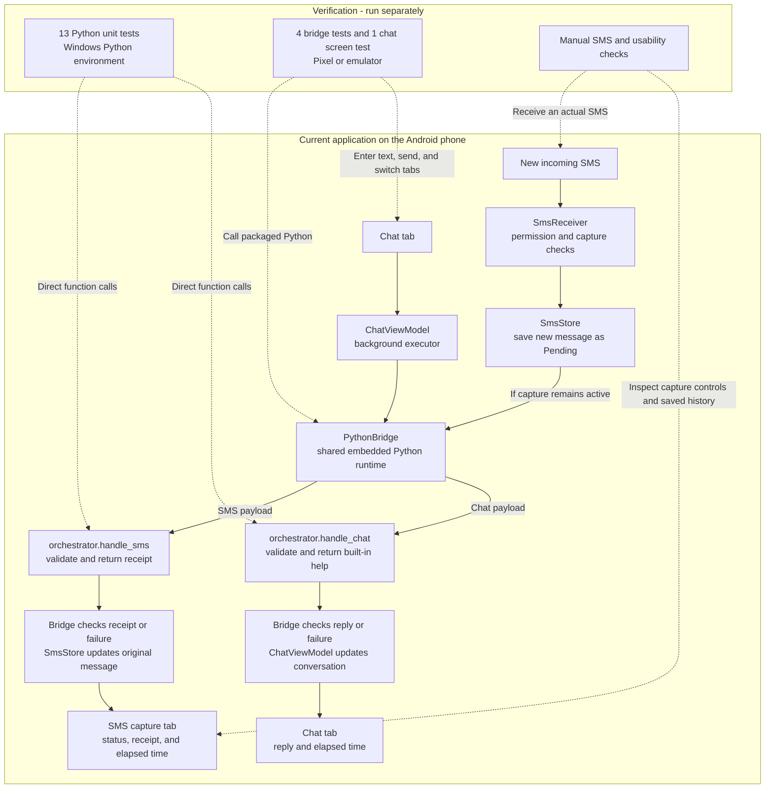
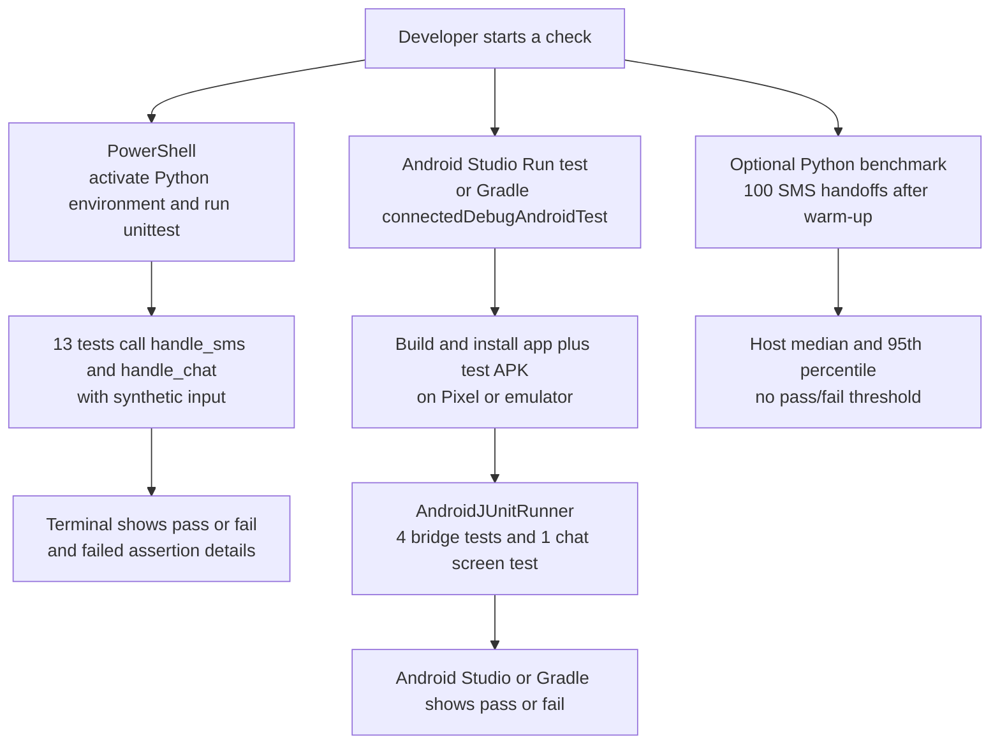
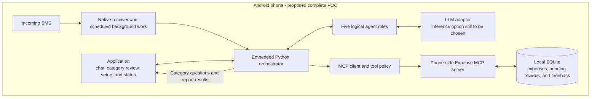

# Android AI Expense Tracker

An Android-only POC for learning MCP, AI agents, and orchestration. The application provides the chat interface and captures new SMS on the same phone.

**Available today:** the app has a Chat tab and an SMS capture tab. Chat sends your message to embedded Python and displays built-in help. SMS capture saves the latest 20 incoming messages and displays Python's acknowledgement. App version: `0.3.0-app-chat`.

**Still planned:** financial classification, expense storage, category review, LLM answers, and phone-side MCP tools. Every current chat message returns capability information; it does not yet interpret questions or record expenses.

The current APK works offline. It needs no WhatsApp account, Twilio, ngrok, public webhook, or laptop service. Open the [Android project and setup guide](android-companion/README.md) to build, install, and run it.

## Current implementation: SMS and app chat

Solid arrows show normal processing. Dotted arrows show what the separately started tests exercise. Python runs inside the APK through Chaquopy.

Tests do not run each time an SMS arrives or a chat message is sent. Python unit tests use your computer's interpreter. Android integration tests use the real bridge and the Python bundled in the APK. The screen test types a message, checks the help reply, and switches tabs. These tests do not send SMS or clear saved capture history.

SMS capture starts off until enabled with permission. Duplicate broadcasts are ignored, and pause/clear invalidates pending updates. Chat is session-only: it keeps the latest 60 entries in memory, survives screen rotation and tab changes, and resets after the app process ends. Captured SMS history remains stored separately on the phone.

### How you run the checks

Start each check from PowerShell or Android Studio. GitHub Actions is not configured; pushing code does not currently run the tests.

Before a demo, run the Python suite, run the Android suites, then do the manual SMS checks. Read a failed assertion, correct the behavior or an incorrect expectation, and rerun the affected suite. The optional benchmark measures host Python processing, excluding Android startup and SMS delivery. See the [test commands](android-companion/README.md#automated-checks) and [manual demo checklist](android-companion/README.md#manual-checks-on-your-pixel-7a).

## Goal: one Android application

1. Install the APK and open its Chat tab for instructions.
2. Enable SMS access to begin automatic tracking.
3. An incoming SMS triggers background processing. The Python orchestrator identifies expenditures, extracts transaction details, and proposes a category.
4. The app asks for category confirmation in its own chat. Replies are attached to the correct pending transaction.
5. The orchestrator calls MCP tools to record the expense in a local database.
6. Ask spending questions in the same chat. The query agent selects MCP tools; the app displays their results.

### Planned architecture

The goal puts the orchestrator, MCP client, MCP server, and expense database on the phone. MCP communication stays inside the application rather than requiring a public internet endpoint. The existing desktop MCP implementation still needs adaptation and an Android compatibility check; it is not included in the APK today.

The remaining model choice is an on-phone model or an external LLM API. An on-phone model requires measuring memory use and inference speed on the Pixel. An external API requires internet access and credentials. This choice is pending; the current chat uses neither option.

### Five agent roles

| Role | Planned responsibility |
| --- | --- |
| Financial-message classifier | Decide whether an SMS describes an expenditure; treat processing failures separately from non-financial messages. |
| Category identification | Extract amount, merchant, currency, and date, then propose a category or return uncertainty. |
| Category validation | Interpret confirmation or correction in the app chat, using the stored pending transaction ID. |
| Training / feedback | Save verified examples and merchant preferences for future predictions; model fine-tuning is a later experiment. A confirmation alone does not retrain a model or prove improved accuracy. |
| User-query handler | Select approved MCP tools for spending questions and display their stored-data results in the app chat. |

These are logical roles for learning, not five continuously running models. The Python orchestrator controls which role runs next. Pending reviews must be stored: do not keep a Python call open while waiting for a reply. A late correction updates the existing expense. Unanswered proposed categories remain unconfirmed and are excluded from verified feedback.

### Next verifiable steps

1. Choose and test inference with a small set of synthetic financial/non-financial SMS examples, recording accuracy and latency.
2. Adapt the MCP server to Android and verify local record/query tools with SQLite.
3. Connect chat queries to the LLM and MCP tools; replace the built-in help-only response.
4. Add category review, correction, and saved feedback in the app.
5. Add weekly reports shown in the app, with Android scheduling/notifications if background reminders are needed.

Future network/model work must use separately scheduled Android background work. The current receiver only performs a short local acknowledgement within its limited execution window.

## Earlier WhatsApp POC

The [v0.1.0 release](https://github.com/Abijith97/expense-tracker-with-mcp/releases/tag/v0.1.0) preserves the earlier WhatsApp/Twilio/FastAPI/Ollama/MCP solution. Its root-level Python files remain available as reference code and are not dependencies of the Android APK. The app-only implementation is under `android-companion/`; do not start `main.py` or ngrok to use it.
