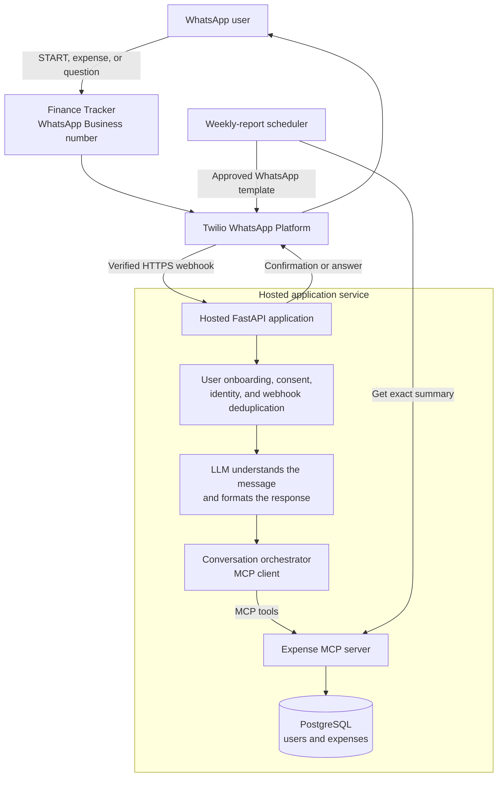

# WhatsApp AI Expense Tracker

## End goal architecture

The end product is a hosted, multi-user WhatsApp finance tracker. Users message one WhatsApp Business number, receive a private account associated with their phone number, record expenses in natural language, and ask questions such as “How much did I spend on food last week?”



The MCP server exposes focused operations such as `record_expense`, `get_weekly_summary`, `compare_weeks`, and `get_category_trend`. Each expense belongs to one user account. The database—not the LLM—calculates totals and comparisons, while the LLM handles natural-language understanding and friendly responses.

## Example user journey

The user needs only WhatsApp; they do not install the application or configure Twilio.

```text
User: START

Finance Tracker: Welcome. Reply YES to create your private tracker.

User: YES

Finance Tracker: Which currency do you use?

User: INR

Finance Tracker: Your tracker is ready. Try: “Lunch ₹120 today”.

User: Paid ₹850 for groceries yesterday

Finance Tracker: Added: Groceries — ₹850 on 25 Aug 2026.

User: Compare this week with last week

Finance Tracker: This week: ₹4,250. Last week: ₹3,100.
Increase: ₹1,150 (37%). Largest increase: Food (+₹720).
```

The user can later ask for summaries in natural language and manage their account through commands such as `PROFILE`, `EXPORT`, `DELETE MY DATA`, and `STOP`.
