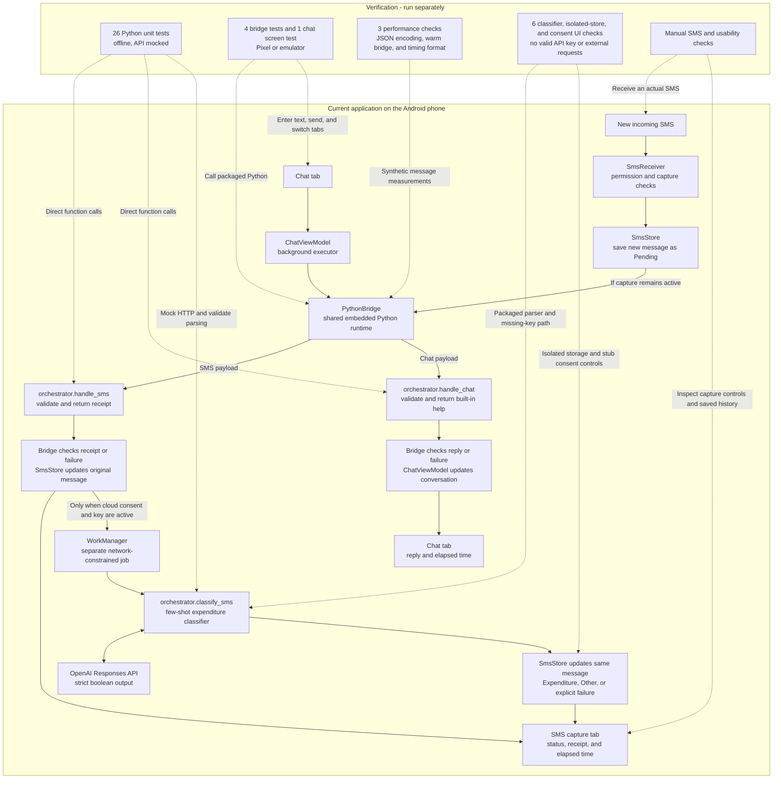
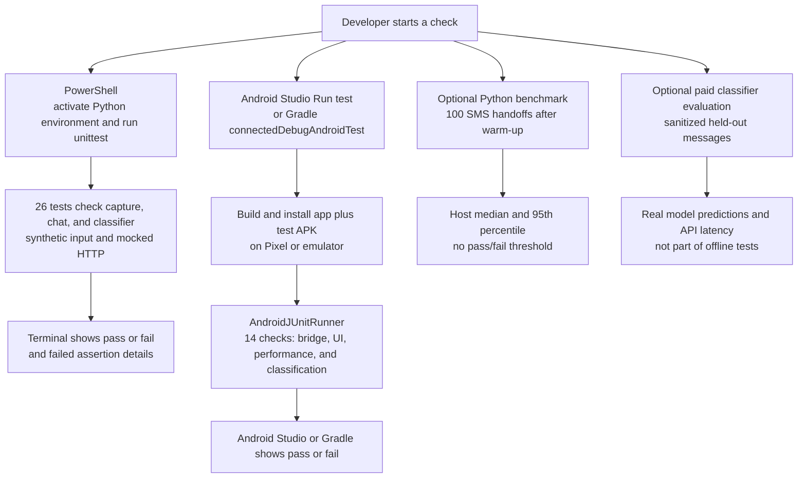
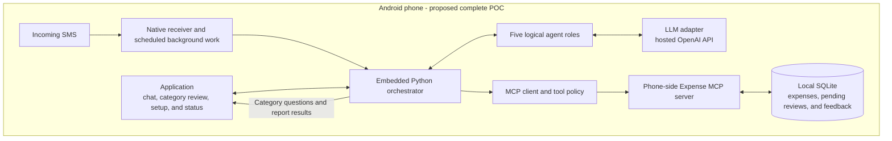

# Android AI Expense Tracker

An Android-only POC for learning MCP, AI agents, and orchestration. The application provides the chat interface and captures new SMS on the same phone.

**Available today:** the app has a Chat tab and an SMS capture tab. Chat sends your message to embedded Python and displays built-in help. SMS capture saves the latest 20 incoming messages and displays Python's acknowledgement plus stage timings. Optional hosted OpenAI classification labels messages **Expenditure** or **Other**, with separate inference timings. App version: `0.4.0-expenditure-classification`.

**Still planned:** transaction extraction, expense storage, category review, LLM chat answers, and phone-side MCP tools. Every current chat message returns capability information; it does not yet interpret questions or record expenses.

Capture and built-in chat help work offline. Hosted classification needs internet, your own API key, and explicit upload consent. It needs no WhatsApp account, Twilio, ngrok, public webhook, or laptop service. Open the [Android project and setup guide](android-companion/README.md) to build, install, and run it.

## Progress — October 3, 2026

- SMS capture and the Kotlin-to-embedded-Python JSON handoff work on the Pixel 7a running Android 17. Real-message screenshots showed receiver entry to handoff result of **185.242 ms** when Python started and **7.548 ms** with Python already running. JSON encoding alone took **0.077 ms** and **0.027 ms**, respectively. These are two observations, not performance guarantees; they exclude SMS delivery and the later hosted classification.
- Hosted expenditure classification is implemented and installed. The user reports correct predictions for the messages tried on the phone. This verifies the live path for those samples, not a measured accuracy percentage or perfect classification for all messages.
- The few-shot prompt uses sanitized examples based on 25 outgoing-payment SMS and nine non-payment SMS, with additional synthetic counterexamples. This is prompting, not model training. Results and hosted-call latency appear separately from capture timings.
- On October 2, all **26 offline Python tests** and **14 Android checks** passed; debug APK builds and lint passed. Automated tests do not make paid API calls or establish model accuracy.

**Scope decision:** sender/source validation and transaction ownership checks are deferred to avoid expanding the current POC. The classifier sees the SMS body, so a friend copying a bank alert can receive an Expenditure label. That label means the text describes an outgoing payment, not that the payment is verified as the user's. No source filter or ownership-confirmation feature has been added. Classification still does not insert an expense or affect spending totals.

The next functional milestone remains transaction-detail extraction and category identification, followed by review and phone-side MCP/database integration. Ownership validation can be revisited later.

## Current implementation: SMS and app chat

Solid arrows show normal processing. Dotted arrows show what the separately started tests exercise. Python runs inside the APK through Chaquopy.

Tests do not run each time an SMS arrives or a chat message is sent. Python unit tests use your computer's interpreter. Android integration tests use the real bridge and the Python bundled in the APK. The screen test types a message, checks the help reply, and switches tabs. These tests do not send SMS or clear saved capture history.

SMS capture starts off until enabled with permission. Cloud uploads also start off; enter the key privately on the phone and accept consent in the SMS capture tab. The API key and cloud consent exist only in phone process memory, not Git, the APK, logs, or saved state. An Android process restart requires entering the key again. Enabling cloud does not replay existing history, but each saved card has an explicit upload/reclassify button when enabled. Direct use of a personal key is a POC tradeoff, not a key-protection design for distributing this app.

The cloud request sends the complete SMS body, which may contain sensitive information; it does not separately send the sender, message ID, or phone metadata. Use synthetic SMS for demos. WorkManager stores only IDs and tokens. It waits for network/system scheduling, but is not a latency optimization. Errors are not classified as Other; retry is manual. Duplicate broadcasts are ignored, and pause/clear invalidates pending updates. Already-sent requests cannot be recalled. Chat is session-only: it keeps the latest 60 entries in memory, survives screen rotation and tab changes, and resets after the app process ends. Captured SMS history remains stored separately on the phone.

### How you run the checks

Start each check from PowerShell or Android Studio. GitHub Actions is not configured; pushing code does not currently run the tests.

Before a demo, run the Python suite, run the Android suites, then do the manual SMS checks. Read a failed assertion, correct the behavior or an incorrect expectation, and rerun the affected suite. The optional benchmark measures host Python processing, excluding Android startup and SMS delivery. See the [test commands](android-companion/README.md#automated-checks) and [manual demo checklist](android-companion/README.md#manual-checks-on-your-pixel-7a).

For bottleneck testing, new SMS cards show receiver entry to JSON readiness, JSON encoding time, and the individual setup/wait/save/Python stages. Device benchmarks report median and 95th-percentile serialization and warm bridge timings. Actual SMS delivery and app detection cannot be isolated from the SMS-provided timestamp alone; see the [measurement definitions and device benchmark guide](android-companion/README.md#sms-bottleneck-measurements).

## Goal: one Android application

1. Install the APK and open its Chat tab for instructions.
2. Enable SMS access to begin automatic tracking.
3. An incoming SMS triggers background processing. The Python orchestrator identifies expenditures, extracts transaction details, and proposes a category.
4. The app asks for category confirmation in its own chat. Replies are attached to the correct pending transaction.
5. The orchestrator calls MCP tools to record the expense in a local database.
6. Ask spending questions in the same chat. The query agent selects MCP tools; the app displays their results.

### Planned architecture

The goal puts the orchestrator, MCP client, MCP server, and expense database on the phone. MCP communication stays inside the application rather than requiring a public internet endpoint. The existing desktop MCP implementation still needs adaptation and an Android compatibility check; it is not included in the APK today.

Hosted OpenAI inference is the selected POC approach. The expenditure classifier uses the Responses API and a few-shot prompt, defaulting to `gpt-5.6-luna` with reasoning effort `none`; the model ID can be changed in the app. Chat still returns local built-in help. The model does not write to a database, call MCP tools, or train itself in this milestone. [OpenAI model documentation](https://developers.openai.com/api/docs/models/gpt-5.6-luna), [structured outputs](https://developers.openai.com/api/docs/guides/structured-outputs).

### Five agent roles

| Role | Planned responsibility |
| --- | --- |
| Financial-message classifier | Decide whether an SMS describes an expenditure; treat processing failures separately from non-financial messages. |
| Category identification | Extract amount, merchant, currency, and date, then propose a category or return uncertainty. |
| Category validation | Interpret confirmation or correction in the app chat, using the stored pending transaction ID. |
| Training / feedback | Save verified examples and merchant preferences for future predictions; model fine-tuning is a later experiment. A confirmation alone does not retrain a model or prove improved accuracy. |
| User-query handler | Select approved MCP tools for spending questions and display their stored-data results in the app chat. |

These are logical roles for learning, not five continuously running models. The Python orchestrator controls which role runs next. Pending reviews must be stored: do not keep a Python call open while waiting for a reply. A late correction updates the existing expense. Unanswered proposed categories remain unconfirmed and are excluded from verified feedback.

### Next verifiable steps

1. Initial live classification is working in the user's phone checks. Broaden the synthetic expenditure/other evaluation and optionally run the paid held-out evaluation to record accuracy and latency. Offline mocked tests do not establish model accuracy; sender/ownership validation is deferred.
2. Adapt the MCP server to Android and verify local record/query tools with SQLite.
3. Connect chat queries to the LLM and MCP tools; replace the built-in help-only response.
4. Add category review, correction, and saved feedback in the app.
5. Add weekly reports shown in the app, with Android scheduling/notifications if background reminders are needed.

Network/model work uses separately scheduled Android background work. The receiver performs a short local acknowledgement within its limited execution window and enqueues classification; it does not wait for inference.

## Earlier WhatsApp POC

The [v0.1.0 release](https://github.com/Abijith97/expense-tracker-with-mcp/releases/tag/v0.1.0) preserves the earlier WhatsApp/Twilio/FastAPI/Ollama/MCP solution. Its root-level Python files remain available as reference code and are not dependencies of the Android APK. The app-only implementation is under `android-companion/`; do not start `main.py` or ngrok to use it.
