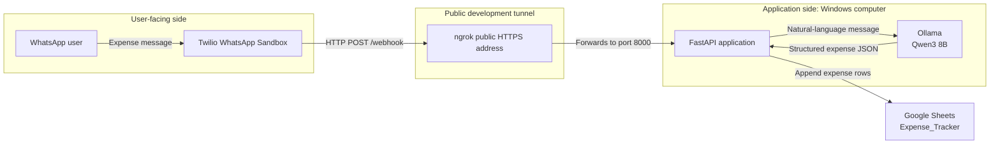
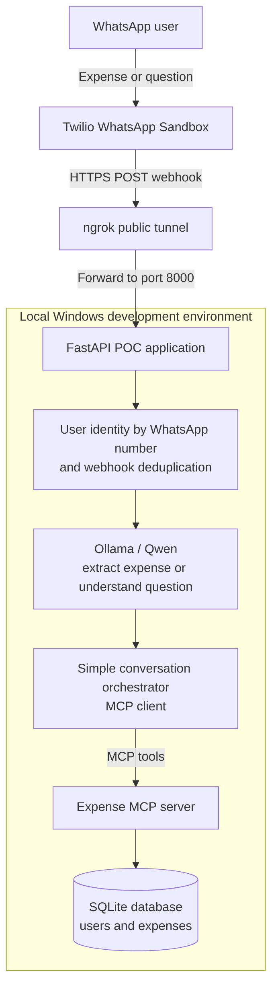

# WhatsApp AI Expense Tracker

A Windows-first personal expense tracker. Send a natural-language WhatsApp message, and the application uses a local Qwen3 model through Ollama to extract expenses and append them to a Google Sheet.

> This project does **not** use MCP. It has three parts: a user-facing WhatsApp/Twilio side, the local Windows application, and an ngrok tunnel that connects them during development.

## Architecture



| Part | Responsibility |
| --- | --- |
| User-facing side | WhatsApp is where the user sends expenses. Twilio receives the message and sends a webhook. |
| Tunnel | ngrok gives Twilio a public HTTPS URL and forwards each webhook to the local Windows app. |
| Application side | FastAPI receives the webhook, Ollama/Qwen3 extracts expense data, and Google Sheets stores it. |

All components in the **Application side** run locally on Windows. Twilio and Google Sheets are cloud services.

## Goal architecture

The next goal is a proof of concept for a multi-user WhatsApp finance tracker. A user will be identified by their WhatsApp number, log expenses in natural language, and ask simple questions such as “How much did I spend on food last week?” This remains a local development project; production hosting, scheduled reports, dashboards, billing, and enterprise onboarding are intentionally out of scope for now.



The MCP server will expose focused operations such as `record_expense`, `get_weekly_summary`, `compare_weeks`, and `get_category_trend`. The database—not the LLM—will calculate totals and comparisons. Google Sheets can remain an optional export while the POC is being developed.

## User experience goal

The future product should be usable entirely through WhatsApp. A user will not install Python, ngrok, or configure Twilio; they will message the service's WhatsApp Business number and receive a private tracker associated with their phone number.

### First-time setup

```text
User: START

Finance Tracker:
Welcome! I can record expenses and answer questions about your spending.
Your expense data is private to this WhatsApp number.
Reply YES to agree to the privacy terms.

User: YES

Finance Tracker:
Which currency do you use?
1. INR
2. USD
3. Other

User: INR

Finance Tracker:
Would you like a weekly spending summary every Sunday?
Reply YES or NO.

User: YES

Finance Tracker:
Done—your tracker is ready.
Try: “Lunch ₹120 today”
Or ask: “How much did I spend this week?”
```

### Everyday use

```text
User: Paid ₹850 for groceries yesterday

Finance Tracker:
Added: Groceries — ₹850 on 25 Aug 2026.

User: Compare this week with last week

Finance Tracker:
This week: ₹4,250
Last week: ₹3,100
Increase: ₹1,150 (37%)

Largest increase: Food (+₹720)
```

Users should be able to manage their data through simple chat commands such as `PROFILE`, `EXPORT`, `DELETE MY DATA`, and `STOP`. The product will not ask for bank passwords, card numbers, or account credentials; it records only expenses the user voluntarily sends. The current Twilio Sandbox join code is development-only and will not be part of this user experience.

## What it does

For a message such as:

```text
I spent Rs 200 on lunch today and Rs 23 on the bus.
```

the application extracts one record for each expense and writes rows like these to Google Sheets:

| Date | Category | Event | Price |
| --- | --- | --- | --- |
| 2026-08-23 | Food | Lunch | 200 |
| 2026-08-23 | Transport | Bus | 23 |

## Setup overview

There are two one-time setup tasks, followed by two commands to run whenever you want to use the tracker:

1. Set up the **application side**: Python, Ollama, Google Sheets, and the project.
2. Set up the **user-facing side**: Twilio WhatsApp Sandbox and your phone.
3. Each time you use the tracker, start FastAPI and then start ngrok.
4. Copy the current ngrok URL to Twilio if it has changed.

## Prerequisites

- Windows 10 or 11
- Python 3.11 or newer
- [Ollama](https://ollama.com/) with the `qwen3:8b` model
- An ngrok account and the ngrok Windows client
- A Twilio account with access to the WhatsApp Sandbox
- A Google account for a Google Cloud service account and Google Sheet

## Application-side setup (one time)

### 1. Clone and install Python dependencies

Open PowerShell and run:

```powershell
git clone https://github.com/Abijith97/expense-tracker-with-mcp.git
cd expense-tracker-with-mcp
py -m venv .venv
.\.venv\Scripts\Activate.ps1
python -m pip install --upgrade pip
pip install -r requirements.txt
```

If PowerShell blocks activation, run this for the current PowerShell session and then activate the environment again:

```powershell
Set-ExecutionPolicy -Scope Process -ExecutionPolicy Bypass
```

### 2. Install and run Ollama

Install Ollama for Windows from [ollama.com](https://ollama.com/), then download the model:

```powershell
ollama pull qwen3:8b
```

Ollama normally starts automatically on Windows. To verify that it is available, run:

```powershell
ollama list
```

The app connects to Ollama at `http://127.0.0.1:11434` by default. You can override this, for example when using another machine, before starting the app:

```powershell
$env:OLLAMA_CLIENT_HOST = "http://192.168.1.10:11434"
```

### 3. Set up Google Sheets

1. Create a Google Sheet named `Expense_Tracker`.
2. Put these headers in the first row: `Date`, `Category`, `Event`, `Price`.
3. In Google Cloud Console, create a project and enable the **Google Sheets API** and **Google Drive API**.
4. Create a service account and download its JSON key.
5. Rename the downloaded file to `service-account.json` and place it in this project folder.
6. Share the Google Sheet with the service account email address as an **Editor**.

`service-account.json` is intentionally ignored by Git. Do not commit or share it.

If your spreadsheet has a different name, set it before launching the app:

```powershell
$env:SPREADSHEET_NAME = "My Expense Sheet"
```

## User-facing setup (one time)

### 4. Configure Twilio WhatsApp Sandbox

1. Sign in to the [Twilio Console](https://console.twilio.com/).
2. Open **Try WhatsApp** and activate the WhatsApp Sandbox if prompted.
3. On your phone, send `join <your sandbox code>` to the Sandbox WhatsApp number, or scan the displayed QR code. Twilio will confirm that your phone has joined the Sandbox.

You will add the webhook address after starting ngrok in the next section. The Sandbox only accepts messages from phone numbers that have joined it. Each tester must join with the current Sandbox code. See Twilio's [WhatsApp quickstart](https://www.twilio.com/docs/whatsapp/quickstart) for the current Console flow.

## Run the application and tunnel (every time)

### 5. Start the FastAPI application

In PowerShell, from the project folder with the virtual environment activated:

```powershell
uvicorn main:app --reload --host 127.0.0.1 --port 8000
```

Leave this terminal running. FastAPI is now listening at `http://127.0.0.1:8000`.

### 6. Start the ngrok tunnel

In a second PowerShell window, authenticate ngrok once using the token from your ngrok dashboard:

```powershell
ngrok config add-authtoken YOUR_NGROK_TOKEN
```

Then start a tunnel to the FastAPI server:

```powershell
ngrok http 8000
```

Copy the HTTPS forwarding address, for example:

```text
https://example-1234.ngrok-free.app
```

ngrok's free URL changes whenever you start a new tunnel. It is suitable for development only.

### How ngrok forwards the Twilio webhook

Your FastAPI app listens at `http://127.0.0.1:8000`. The `127.0.0.1` address is private to your laptop, so Twilio cannot send an internet request directly to it. Starting ngrok with `ngrok http 8000` creates a secure outbound connection from the ngrok program on your laptop to ngrok's cloud service. ngrok then assigns a public HTTPS address to that connection.

After you put that public address into Twilio's Sandbox webhook setting, the flow for every WhatsApp message is:

```text
WhatsApp user
  → Twilio WhatsApp Sandbox
  → HTTPS POST https://your-ngrok-url/webhook
  → ngrok cloud service
  → existing secure ngrok tunnel
  → http://127.0.0.1:8000/webhook on your laptop
  → FastAPI application
```

ngrok does not run FastAPI, Ollama, or the LLM. It only makes the local FastAPI webhook reachable from the public internet. FastAPI receives the message on port `8000`, then separately calls the local Ollama service on port `11434` to extract the expense JSON.

This is similar to an SSH reverse tunnel in concept: both use an outbound connection from your laptop so external traffic can reach a local service. ngrok is designed specifically for HTTP/HTTPS, gives you a public HTTPS URL and TLS certificate, and provides a local request-inspection page at `http://127.0.0.1:4040` while it is running.

### 7. Connect Twilio to the current tunnel

1. In Twilio, open **Try WhatsApp** → **Sandbox settings**.
2. In **When a message comes in**, enter your current ngrok HTTPS address with `/webhook` appended, for example:

   ```text
   https://example-1234.ngrok-free.app/webhook
   ```

3. Select **HTTP POST** and save the settings.

### Should FastAPI start ngrok automatically?

For a personal development project, starting both can be convenient. However, ngrok is better kept separate from `main.py` for now: it has its own authentication token and public URL lifecycle, and separating it makes tunnel failures and public exposure easier to see and control.

A good future convenience improvement is a `start.ps1` script that starts both processes. That keeps the application code focused on expense processing while reducing the number of commands a user must run.

## Test the complete flow

Send a WhatsApp message from the phone that joined the Sandbox:

```text
I spent Rs 200 on lunch today and Rs 23 on the bus.
```

You should see the incoming message, LLM response, and added rows in the FastAPI terminal. Open the Google Sheet to confirm the two rows were added.

## Troubleshooting

| Symptom | Check |
| --- | --- |
| `ModuleNotFoundError` | Activate `.venv` and run `pip install -r requirements.txt`. |
| Ollama connection error | Run `ollama list`; confirm the model is installed and Ollama is running. |
| Google authentication error | Check that `service-account.json` is in the project folder and that the sheet is shared with the service account email. |
| Twilio does not reach the app | Keep both FastAPI and ngrok running, then update the Twilio webhook after every new ngrok URL. |
| No rows appear in Sheets | Review the FastAPI terminal for the extracted JSON or an API error. |

## Security notes

- Never commit `service-account.json` or other credentials.
- ngrok publicly exposes your local server while it runs; use it only for development.
- The current application stores every successfully extracted message as new rows. It does not yet include duplicate-webhook protection or automatic WhatsApp confirmations.
