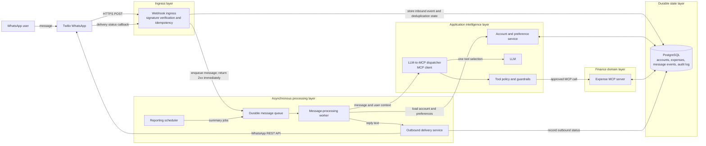
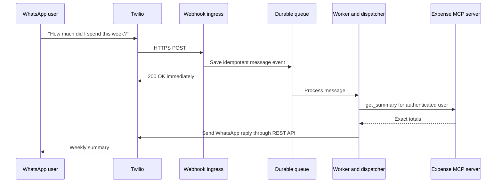

# WhatsApp AI Expense Tracker

## Goal architecture

The goal is a reliable, multi-user WhatsApp finance tracker. A user messages one WhatsApp Business number to record expenses or ask questions. The system processes each message privately, uses MCP tools for finance operations, and sends a reply back to WhatsApp.

The POC currently runs locally with FastAPI, Ollama/Qwen, an in-process MCP server, SQLite, Twilio, and ngrok. The diagram below is the target production architecture: the same responsibilities, separated into dependable system functions.

## Run the current POC (Windows)

You need Python 3.11 or newer, [Ollama](https://ollama.com/), ngrok, a Twilio account with the WhatsApp Sandbox enabled, and this repository cloned locally.

Open **two PowerShell windows**. In the first, create and activate a project-local virtual environment, install dependencies, download the model, and start the application:

```powershell
cd C:\Users\unnia\expense-tracker-with-mcp
py -3.11 -m venv .venv
.\.venv\Scripts\Activate.ps1
python -m pip install -r requirements.txt
ollama pull qwen3:8b
python main.py
```

Create the environment only once. On later runs, open PowerShell in the project folder and run:

```powershell
.\.venv\Scripts\Activate.ps1
python main.py
```

If PowerShell blocks activation, run `Set-ExecutionPolicy -Scope Process Bypass` in that window, then activate it again. Alternatively, run the environment's interpreter directly: `& ".\.venv\Scripts\python.exe" main.py`.

The app starts at `http://127.0.0.1:8000`. It automatically creates `expense_tracker.db` in the project folder if it does not already exist. Ollama must be running locally at `http://127.0.0.1:11434`; on most Windows installations it starts in the background after installation. If it is not running, open another PowerShell window and run `ollama serve`.

In the second PowerShell window, expose the local FastAPI server to Twilio:

```powershell
ngrok http 8000
```

Copy the HTTPS forwarding address printed by ngrok, for example `https://example.ngrok-free.app`, and configure this exact webhook URL in the Twilio WhatsApp Sandbox settings:

```text
https://example.ngrok-free.app/webhook
```

Set the request method to **HTTP POST** and save. In WhatsApp, first send Twilio's displayed `join <sandbox-code>` message to the Sandbox number (when required), then send a natural-language message such as `I spent Rs 120 on lunch today` or `What did I spend this week?`.

Keep the FastAPI and ngrok windows open while testing. ngrok normally gives a new public URL each time it starts, so update the Twilio webhook whenever that URL changes. Press `Ctrl+C` in each window when you are finished.



## System functions

These are layers, not a numbered execution order. The **durable state layer** supports several functions at once; it does not come after them.

| Layer | System function | Uses | Owns |
| --- | --- | --- | --- |
| Channel | **Twilio WhatsApp** | WhatsApp Business platform | The configured WhatsApp channel: accepting user messages, delivering replies, and reporting message delivery events. |
| Ingress | **Webhook ingress** | Twilio and durable state | One safe handoff for each incoming message: parse `Body`, `From`, and `MessageSid`; verify the request; prevent duplicate processing; store the inbound event; and return a fast `2xx`. |
| Durable state | **PostgreSQL** | - | The durable source of truth: accounts, preferences, expenses, inbound events, delivery status, and audit records. It provides private user isolation, idempotency keys, transactions, reporting data, and recovery after a restart. |
| Processing | **Durable queue** | Ingress and scheduler | The lifecycle of queued work: reliable handoff, delayed retry, ordering where required, and retention of work until a worker acknowledges it. |
| Processing | **Worker** | Queue, account service, dispatcher, and delivery service | One processing attempt: load the job, apply retry and time-limit policy, run the application flow outside the webhook, and record failure for review. |
| Intelligence | **Account and preference service** | PostgreSQL | The private user context: identity, currency, timezone, consent, account state, and the lookup that turns a WhatsApp number into an authenticated user. |
| Intelligence | **LLM-to-MCP dispatcher** | Worker, LLM, policy, and MCP client | One natural-language routing step: ask the LLM to select one allowlisted MCP tool, then format its trusted result. It does not own financial facts. |
| Intelligence | **Tool policy and guardrails** | Account context and LLM tool selection | Authorization and input safety: add the authenticated user identity, validate tool arguments, block cross-user access, and require explicit confirmation before deletion. |
| Domain | **Expense MCP server** | Guardrails and PostgreSQL | Finance-domain behavior: record, find, retrieve, summarize, and delete expenses. It calculates exact results from stored data and enforces finance validation. |
| Delivery | **Outbound delivery service** | Worker, PostgreSQL, and Twilio credentials | The outbound message lifecycle: send the final reply through Twilio's REST API, retry safe failures, and store sent, delivered, or failed status. |
| Processing | **Reporting scheduler** | Queue and MCP server | Scheduled job creation: weekly summaries, reminders, and approved template messages. It schedules work; workers perform it. |

## Current POC code map

The POC does not yet have a queue, worker, PostgreSQL, scheduler, or outbound REST delivery service. Its files are nevertheless split along the same boundaries so those production upgrades can be added without turning `main.py` back into one large file.

| Current file | System-function boundary | What to read there |
| --- | --- | --- |
| `main.py` | Application composition | Creates FastAPI, starts the database and MCP server, registers the webhook, and mounts `/mcp`. |
| `webhook_ingress.py` | Webhook ingress | Reads Twilio form data, creates/deduplicates users and webhook events, calls the application flow, and returns TwiML. |
| `llm_mcp_dispatcher.py` | LLM-to-MCP dispatcher | Builds the tool-selection prompt, makes one LLM call, validates the selected MCP arguments, calls one MCP tool, and formats the result. |
| `tool_policy.py` | Tool policy and guardrails | Validates model-proposed values, injects the authenticated WhatsApp number, and prevents the model from confirming deletion. |
| `mcp_client.py` | MCP client boundary | Makes MCP calls from the application to the Expense MCP server. |
| `expense_mcp_server.py` | Finance domain / Expense MCP server | Defines the MCP tools and performs finance operations. |
| `storage.py` | Durable state | Defines SQLite models and database helpers for users, expenses, and webhook events. |
| `responses.py` | Response and delivery formatting | Converts trusted MCP results into WhatsApp text and wraps replies as TwiML. |
| `config.py` | Configuration | Holds environment-driven runtime settings and valid expense categories. |
| `observability.py` | Observability | Provides the masked local trace messages used while debugging. |

## Current POC message flow

The POC intentionally uses one natural-language routing step per user message. It does not use an autonomous agent loop or require users to learn commands.

```text
WhatsApp message
→ Twilio webhook
→ FastAPI webhook ingress
→ LLM selects one MCP tool
→ tool policy validates arguments and adds the WhatsApp user identity
→ Expense MCP server reads or writes SQLite
→ FastAPI returns a TwiML reply
```

For example, “What is this app?” should cause the LLM to select `get_help`; “I had lunch for Rs 120 today” should select `record_expense`. The LLM never accesses the database directly.

## Why the queue is important

Twilio calls the inbound webhook synchronously and expects a quick response. LLM inference can take longer, so the webhook should only validate and enqueue the message. A worker performs the AI and MCP work afterwards, then sends the finished reply through Twilio's outbound API.



## Production upgrade order

1. Add asynchronous outbound delivery: queue the inbound event, return quickly, then use Twilio's REST API from a worker.
2. Move SQLite to PostgreSQL and add migrations, backups, encrypted secrets, and audit records.
3. Add Twilio signature verification, rate limiting, structured logs, metrics, alerts, and a dead-letter queue.
4. Host the API, worker, database, and queue in cloud infrastructure; remove ngrok from the production path.
5. Add onboarding, user settings, exports, account deletion, scheduled reports, and support/admin tooling.

## MCP boundary

FastAPI is the MCP host. The LLM-to-MCP dispatcher is its MCP client. The Expense MCP server is the finance-domain boundary and is the only component allowed to read or change expense data. The LLM never directly queries the database or supplies another user's identity.
