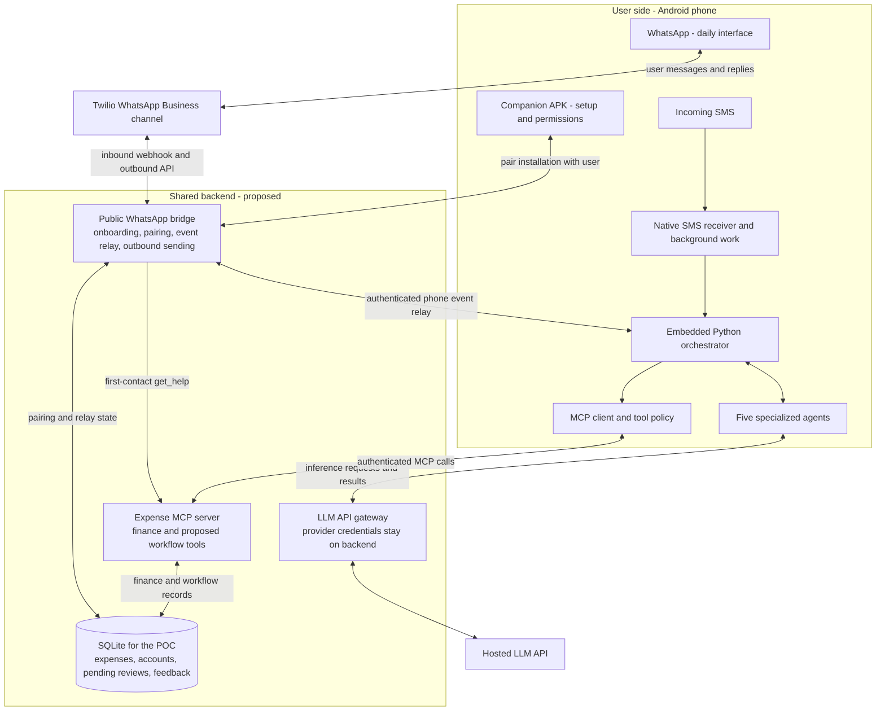

# WhatsApp AI Expense Tracker

An expense-tracking POC for learning MCP, AI agents, and orchestration. WhatsApp is the everyday user interface.

**Available today:** the [v0.1.0 WhatsApp/MCP POC](https://github.com/Abijith97/expense-tracker-with-mcp/releases/tag/v0.1.0), preserved at commit `432b525` before this architecture update. It uses manually entered WhatsApp messages, local Ollama, FastAPI, MCP, and SQLite. The release contains source code, not an Android installer.

**Android milestones 1-2:** [android-companion](android-companion/README.md) is a separate Kotlin/Compose diagnostic app: SMS permission, explicit capture enable/pause, and a local display of the latest 20 incoming SMS messages. It now bundles Python through Chaquopy: Kotlin saves a new SMS, calls the on-phone `orchestrator.handle_sms` entry point, and displays its JSON receipt and elapsed time. This acknowledgement is not expense classification. No Python server, internet, LLM, or WhatsApp connection is involved. Build/install instructions and manual phone checks are in its guide; this is not part of the existing `v0.1.0` release.

**Next goal, not implemented:** expand the Android companion's minimal Python entry point into the orchestrated five-agent workflow below. This is a personal learning POC, not a production-readiness plan. The full goal architecture is separate from the current offline handoff and the existing WhatsApp POC.

## Goal: WhatsApp interface, Android background companion

1. A new user messages the shared WhatsApp Business number. The backend handles first-contact `get_help` and replies with instructions and an APK download link, even before the user has installed anything.
2. The user installs the companion, opens its small setup screen, pairs it with their WhatsApp identity, and grants the required SMS permission after reviewing what data will be processed and sent to an external LLM.
3. An incoming SMS triggers Android background work. The phone-side Python orchestrator calls the financial-message classification agent to decide whether it describes an expenditure.
4. For an expenditure, the system extracts transaction details, proposes a category, and asks the user to confirm or correct it through WhatsApp.
5. The orchestrator records the expense through MCP tools. The user can ask spending questions in WhatsApp; a user-query agent selects the appropriate MCP tools and returns their results.

There is no separate daily-use chat interface or finance dashboard. The installed component is still an Android application (APK): a service cannot be distributed as a standalone Windows-style background service. A setup/status screen provides permissions, pairing, and a way to pause tracking. Python can be embedded in that APK, but the existing desktop program and its dependencies must be adapted and verified on Android. See [Android services](https://developer.android.com/develop/background-work/services) and [Python on Android](https://docs.python.org/3/using/android.html).

### Planned architecture



The orchestrator runs **on the phone** in this goal architecture. The backend is still needed: Twilio requires a public webhook, new users need help before installing the APK, and the shared account needs a place to send WhatsApp messages. The phone is not itself a public webhook. Backend-to-phone event delivery needs an authenticated relay; the push/poll mechanism is still to be chosen. Offline phones delay phone-side processing. [Twilio webhook requirements](https://www.twilio.com/docs/usage/webhooks/getting-started-twilio-webhooks)

"Background" means event-triggered work, not an indefinitely running Python process. Android background limits, SMS permissions, and Python package compatibility are part of the first feasibility check. `RECEIVE_SMS` is a restricted permission, so downloading an APK does not by itself grant access. This design covers SMS, not email or RCS. [Android background work](https://developer.android.com/develop/background-work/background-tasks), [SMS permission](https://developer.android.com/reference/android/Manifest.permission#RECEIVE_SMS)

### Five agents and the orchestrator

These are logical roles for learning; they do not require five separate models or continuously running processes. Some begin as one prompt and one model call. The orchestrator owns routing, state, and the next action.

| Component | Responsibility and output |
| --- | --- |
| Financial-message classification agent | Use a few-shot prompt containing user-provided examples to classify **expenditures**. Return `true` or `false`; a network/model failure is an error, not `false`. Salary credits, refunds, offers, OTPs, and failed payments are not spending. Define a rule for ambiguous transfers before evaluation. |
| Category identification agent | Propose a category from agreed examples/categories and confirmed user preferences retrieved through MCP, or return `not sure`. The workflow also needs structured extraction of amount, currency, merchant, date, and transaction direction; a category alone cannot create an expense. |
| Category validation agent | Interpret the proposed category and the user's WhatsApp reply. Return structured accepted/corrected/rejected/unclear status and a category where supplied; the orchestrator attaches the trusted transaction ID from the pending review. A bare "no" requires a follow-up, not a guessed correction. |
| Training / feedback agent | Save the original transaction message with its verified category and user-specific preferences. Start with corrected examples or merchant preferences; model fine-tuning is a later experiment. A "yes" does not automatically retrain an LLM or prove better accuracy. Evaluate changes on held-out labelled messages. |
| User-query agent | Interpret questions such as "What did I spend this week?", select approved MCP tools, and return their results through WhatsApp. Totals come from stored records, not model guesses. |
| Python orchestrator | Receive SMS and relayed WhatsApp events, invoke agents, persist pending work, correlate replies, apply tool policy, call MCP tools, and request outbound messages through the backend. LangGraph is a candidate, subject to Android compatibility validation. |

### State, MCP, and WhatsApp replies

- **Save before asking:** persist a pending transaction and question ID in the backend database before sending a category question. Link the outbound WhatsApp message ID to that transaction. The phone needs local processing checkpoints and a resume/synchronization path to those records; do not depend on a Python function staying alive while the user replies.
- **Route the reply:** the WhatsApp webhook reaches the backend, which relays an event to the paired phone. Explicit replies or transaction IDs identify the pending question. If several questions are pending, an unqualified "yes" needs clarification. An unrelated spending question goes to the user-query agent.
- **Handle silence and late replies:** choose a review timeout during implementation. On expiry, retain the proposed category as unconfirmed (or `Uncategorized` if uncertain), never as verified training data. A late correction updates the same expense instead of inserting another.
- **Keep MCP explicit:** the phone-side orchestrator hosts the MCP client; the backend hosts the Expense MCP server. Agents propose actions, policy validates them, and server-side authorization binds tool calls to the paired user. The LLM never writes directly to the expense database. The current tools need extensions for pending reviews, category correction, and feedback; the existing `/mcp` endpoint is not ready to expose as an authenticated multi-user remote service.
- **Keep sending separate from inference:** acknowledge and store webhook events promptly, then send completed answers through the outbound WhatsApp API. This avoids keeping a webhook open while the phone or model works; it does not make inference faster. This delivery change is planned, not implemented.
- **Later weekly reports:** a backend scheduler can trigger a Sunday 20:00 `Asia/Kolkata` summary through MCP and request WhatsApp delivery. The agent does not watch the clock. Proactive sending must respect WhatsApp's messaging window and template requirements. [WhatsApp messaging rules](https://www.twilio.com/docs/whatsapp/api)

For the POC, the shared database can remain SQLite with schema additions; PostgreSQL and a production queue are not prerequisites for the first SMS experiment. Provider secrets stay on the backend, and pairing must not rely on trusting a phone number supplied by the model or client. Hosted classification sends SMS text off-device through the gateway, not just extracted transaction fields; setup must explain this before tracking is enabled.

### First verifiable milestone

Prove **real Android SMS -> background work -> embedded Python orchestrator -> classification agent -> expenditure result** before implementing the other agents.

1. Install a minimal companion on the actual phone and verify SMS permission and receipt using synthetic messages.
2. Trigger Python processing from the Android receiver without blocking the receiver on a network call.
3. Classify a small set of redacted expenditure/non-expenditure examples through the hosted LLM API, logging a message ID, result, and per-stage timings rather than full personal SMS content.
4. Manually check screen-locked operation, temporary loss of internet, retries without duplicate processing, and model/network timeouts. Treat force-stop separately from normal background operation.

Success means the expected labels appear in diagnostic output and failures are visible. It does not yet demonstrate WhatsApp category confirmation, fix the existing WhatsApp delivery issue, or train a model. Local capture and the embedded Python acknowledgement are now implemented for building and manual phone checks; financial classification and a public APK download endpoint remain future work.

## Run the current POC (Windows)

You need Python 3.11 or newer, [Ollama](https://ollama.com/), ngrok, a Twilio account with the WhatsApp Sandbox enabled, and this repository cloned locally.

Open **two PowerShell windows**. In the first, create and activate a project-local virtual environment, install dependencies, download the model, and start the application:

```powershell
cd C:\Users\unnia\expense-tracker-with-mcp
py -3.11 -m venv .venv
.\.venv\Scripts\Activate.ps1
python -m pip install -r requirements.txt
ollama pull qwen3:8b
python main.py
```

Create the environment only once. On later runs, open PowerShell in the project folder and run:

```powershell
.\.venv\Scripts\Activate.ps1
python main.py
```

If PowerShell blocks activation, run `Set-ExecutionPolicy -Scope Process Bypass` in that window, then activate it again. Alternatively, run the environment's interpreter directly: `& ".\.venv\Scripts\python.exe" main.py`.

The app starts at `http://127.0.0.1:8000`. It automatically creates `expense_tracker.db` in the project folder if it does not already exist. Ollama must be running locally at `http://127.0.0.1:11434`; on most Windows installations it starts in the background after installation. If it is not running, open another PowerShell window and run `ollama serve`.

In the second PowerShell window, expose the local FastAPI server to Twilio:

```powershell
ngrok http 8000
```

Copy the HTTPS forwarding address printed by ngrok, for example `https://example.ngrok-free.app`, and configure this exact webhook URL in the Twilio WhatsApp Sandbox settings:

```text
https://example.ngrok-free.app/webhook
```

Set the request method to **HTTP POST** and save. In WhatsApp, first send Twilio's displayed `join <sandbox-code>` message to the Sandbox number (when required), then send a natural-language message such as `I spent Rs 120 on lunch today` or `What did I spend this week?`.

Keep the FastAPI and ngrok windows open while testing. Use the HTTPS forwarding URL shown by ngrok and update the Twilio webhook whenever it changes. Press `Ctrl+C` in each window when you are finished.

## Current POC code map

These are the files in the existing server-side Python implementation, not the proposed Android agents. The separate Android companion captures SMS and runs a local Python acknowledgement only. Hosted LLM integration, full agent orchestration, a phone event relay, training, scheduling, and outbound REST delivery are not implemented yet.

| Current file | System-function boundary | What to read there |
| --- | --- | --- |
| `main.py` | Application composition | Creates FastAPI, starts the database and MCP server, registers the webhook, and mounts `/mcp`. |
| `webhook_ingress.py` | Webhook ingress | Reads Twilio form data, creates/deduplicates users and webhook events, calls the application flow, and returns TwiML. |
| `llm_mcp_dispatcher.py` | LLM-to-MCP dispatcher | Builds the action-plan prompt, makes one LLM call, validates up to three selected MCP actions, calls them in order, and formats trusted results. |
| `tool_policy.py` | Tool policy and guardrails | Validates model-proposed values, injects the webhook sender identity, and checks explicit deletion confirmation. Webhook request authentication is still pending. |
| `mcp_client.py` | MCP client boundary | Makes MCP calls from the application to the Expense MCP server. |
| `expense_mcp_server.py` | Finance domain / Expense MCP server | Defines the MCP tools and performs finance operations. |
| `storage.py` | Durable state | Defines SQLite models and database helpers for users, expenses, and webhook events. |
| `responses.py` | Response and delivery formatting | Converts trusted MCP results into WhatsApp text and wraps replies as TwiML. |
| `config.py` | Configuration | Holds environment-driven runtime settings and valid expense categories. |
| `observability.py` | Observability | Provides the masked local trace messages used while debugging. |

## Current POC message flow

The POC intentionally uses one natural-language planning step per user message. It does not use an autonomous agent loop or require users to learn commands. The LLM may choose one to three independent MCP actions, in the order requested by the user.

```text
WhatsApp message
→ Twilio webhook
→ FastAPI webhook ingress
→ LLM selects a bounded MCP action plan
→ tool policy validates arguments and adds the WhatsApp user identity
→ Expense MCP server performs each approved action against SQLite
→ FastAPI returns a TwiML reply
```

For example, “What is this app?” should cause the LLM to select `get_help`; “I had lunch for Rs 120 today” should select `record_expense`. A message such as “I spent Rs 120 on travel and find yesterday's lunch expenses to delete” can select `record_expense` followed by `find_expenses`.

Deletion remains deliberately separate. If the user does not provide the expense IDs and explicit confirmation, the app finds and displays the candidate expenses but does not delete them. It asks the user to confirm the specific IDs in a later natural-language message. The LLM never accesses the database directly.

The current FastAPI application hosts an **in-process MCP client and server**. Moving the client into an Android companion and exposing authenticated remote MCP tools is future work, not just a configuration change.

## Known limitation of the released POC

The existing webhook waits for the LLM and returns the answer as TwiML. In the reported manual run, LLM selection took **33.867 seconds** and the full webhook took **34.350 seconds**; a reply was generated but did not arrive in WhatsApp. A webhook delivery timeout is suspected, not confirmed from provider logs. See [issue #1](https://github.com/Abijith97/expense-tracker-with-mcp/issues/1).

A hosted LLM may reduce inference time, while prompt acknowledgement and separate outbound messaging remove the need to finish that inference within the inbound webhook. These are different improvements, and neither is implemented by this README update. A `webhook_completed` log is not confirmation of WhatsApp delivery.

The release is a learning snapshot, not a production-secured deployment. Request authentication, remote MCP authorization, background delivery, and mobile permission handling need implementation and verification before sharing the planned service with other users.
