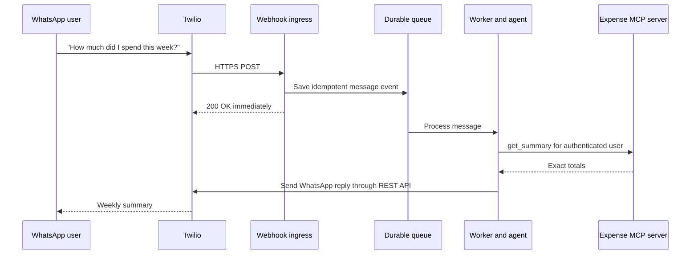

# WhatsApp AI Expense Tracker

## Goal architecture

The goal is a reliable, multi-user WhatsApp finance tracker. A user messages one WhatsApp Business number to record expenses or ask questions. The system processes each message privately, uses MCP tools for finance operations, and sends a reply back to WhatsApp.

The POC currently runs locally with FastAPI, Ollama/Qwen, an in-process MCP server, SQLite, Twilio, and ngrok. The diagram below is the target production architecture: the same responsibilities, separated into dependable system functions.

```mermaid
flowchart LR
    User[WhatsApp user]
    Twilio[1. Twilio WhatsApp channel]
    Ingress[2. Webhook ingress<br/>validation and idempotency]
    Identity[3. User identity and preferences]
    Queue[4. Durable message queue]
    Worker[5. Message-processing worker]
    Agent[6. Controlled agent orchestrator<br/>MCP client]
    LLM[LLM]
    Policy[7. Tool policy and guardrails]
    MCP[8. Expense MCP server]
    Data[(9. PostgreSQL<br/>expenses, events, audit log)]
    Delivery[10. Outbound delivery service]
    Scheduler[11. Reporting scheduler]

    User -->|message| Twilio
    Twilio -->|HTTPS POST| Ingress
    Ingress -->|verify sender; deduplicate| Identity
    Ingress -->|store event; return 2xx immediately| Queue
    Queue --> Worker
    Worker -->|load profile and message| Agent
    Agent <-->|tool plan and tool result| LLM
    Agent --> Policy
    Policy -->|approved MCP call| MCP
    MCP <--> Data
    Worker -->|reply text| Delivery
    Delivery -->|WhatsApp REST API| Twilio
    Twilio -->|delivery status| Ingress
    Scheduler -->|summary jobs| Queue
```

## System functions and dependencies

| Order | System function | Depends on | Production responsibility |
| --- | --- | --- |
| 1 | **WhatsApp channel** | WhatsApp Business and Twilio | Receives messages and delivers replies. |
| 2 | **Webhook ingress** | Twilio | Verifies Twilio signatures, parses messages, deduplicates `MessageSid`, records the event, and returns a fast `2xx` response. |
| 3 | **Identity and preferences** | Database | Maps a WhatsApp number to one private user, currency, timezone, consent, and account state. |
| 4 | **Durable queue** | Webhook ingress | Stores work safely so a slow LLM, restart, or retry cannot lose a message. |
| 5 | **Message-processing worker** | Queue and identity | Runs work outside the webhook request, controls retries, and sends failed jobs to a dead-letter queue for review. |
| 6 | **Controlled agent orchestrator** | Worker and LLM | Interprets the message, chooses only allowlisted MCP tools, limits tool calls, and composes a response. |
| 7 | **Tool policy and guardrails** | Identity and agent | Adds the authenticated user identity, validates tool arguments, enforces confirmation for destructive actions, and prevents cross-user access. |
| 8 | **Expense MCP server** | Tool policy and database | Owns the finance operations: record, find, retrieve, summarize, and delete expenses. |
| 9 | **Data and audit layer** | MCP server and ingress | Stores users, expenses, webhook events, delivery status, and an audit trail. PostgreSQL replaces local SQLite in production. |
| 10 | **Outbound delivery service** | Worker and Twilio credentials | Sends the completed reply with the Twilio REST API and records its delivery status. |
| 11 | **Reporting scheduler** | Queue and MCP server | Schedules weekly summaries, comparisons, reminders, and approved template messages. |

## Why the queue is important

Twilio calls the inbound webhook synchronously and expects a quick response. LLM inference can take longer, so the webhook should only validate and enqueue the message. A worker performs the AI and MCP work afterwards, then sends the finished reply through Twilio's outbound API.

## Production upgrade order

1. Add asynchronous outbound delivery: queue the inbound event, return quickly, then use Twilio's REST API from a worker.
2. Move SQLite to PostgreSQL and add migrations, backups, encrypted secrets, and audit records.
3. Add Twilio signature verification, rate limiting, structured logs, metrics, alerts, and a dead-letter queue.
4. Host the API, worker, database, and queue in cloud infrastructure; remove ngrok from the production path.
5. Add onboarding, user settings, exports, account deletion, scheduled reports, and support/admin tooling.

## MCP boundary

FastAPI is the MCP host. The controlled agent is its MCP client. The Expense MCP server is the finance-domain boundary and is the only component allowed to read or change expense data. The LLM never directly queries the database, supplies another user's identity, or confirms a deletion.
