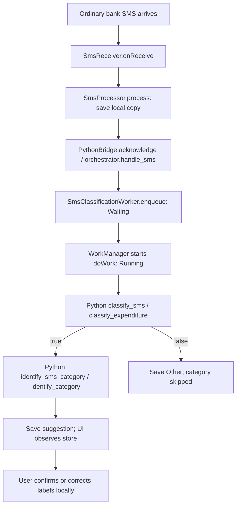

# Persona-based testing: BMTC payment of Rs.23

[Testing wiki](Home.md) | [Method pages](Home.md#component-pages)

## Persona and goal

A commuter pays Rs.23 to BMTC and receives an ordinary bank SMS. They want the tracker to capture the SMS, identify it as expenditure, suggest `utilities / transport`, and let them confirm or correct that suggestion.

The app sees the **SMS**, not the payment itself. This persona is a documented acceptance test (**M**), not a claim that a complete end-to-end automated test has passed.

## Preconditions and safe fixture

Use a development device/emulator with SMS permission and capture enabled. For an intentional live inference check, enable cloud with two distinct private API keys and upload consent. Remembered settings are optional. Never put literal keys into documentation or commands. Live inference sends the body to OpenAI and can incur charges; use synthetic text only.

```text
Sent Rs.23.00
From HDFC Bank A/C *0000
To BMTC
On 11/10/26
Ref 123456789
```

Do not make a real payment just to run this test. A debug simulator exercises the shared processor, but bypasses broadcast reception and cannot verify actual delivery or closed-app capture. A mocked model result verifies routing/contracts, not classification accuracy.

## Current code flow



1. [SmsReceiver](Method-Tests-SmsReceiver.md) checks the SMS action, permission and capture token. It combines multipart content and hashes sender/timestamp/body to identify duplicates.
2. [SmsProcessor](Method-Tests-SmsProcessor.md) saves the card using `SmsStore.append()` before handoff. `SmsPayload.encode()` builds the versioned JSON contract.
3. [PythonBridge](Method-Tests-PythonBridge.md) calls embedded `orchestrator.handle_sms()` and validates its receipt. `completeHandoff()` stores **Acknowledged**. No network/LLM inference occurs in this local path.
4. [Worker enqueue](Method-Tests-SmsClassificationWorker.md) checks the enabled cloud session, prepares a unique Waiting attempt and schedules network-constrained work. WorkManager stores IDs/tokens, not body/keys. There may be scheduling delay.
5. `doWork()` rechecks permission/session/capture/attempt. It calls `PythonBridge.classifySms()` -> `orchestrator.classify_sms()` -> `classify_expenditure()` -> `build_request()` -> `llm_api.send_request()` -> `parse_response()`. The model's expected content is `{"is_expenditure": true}`. Strict boolean validation converts this to **Expenditure**, not a ledger write.
6. `withCategoryIfExpenditure()` gates the second stage after renewed authorization checks. `PythonBridge.identifyCategory()` -> `orchestrator.identify_sms_category()` -> `identify_category()` makes a separate hosted request using the category key. The prompt contains the user's BMTC preference; the expected content is `{"category":"utilities","sub_category":"transport"}`. This is a prompted prediction, not a deterministic lookup or trained-feedback result.
7. `SmsStore.finishClassification()` saves the correlated result. `MainActivity` collects store state and displays the card, timings, requests and available usage/cost estimates.
8. [Category review](Method-Tests-Category-Review.md) shows Yes/No. Yes saves labels through `confirmCategory()`. No opens empty correction fields with examples/custom labels. A later edit uses `editCategory()`. The recording switch calls `setRecordExpenditure()` independently.

## Acceptance checkpoints

| Case | Action / observation | Expected result | Evidence |
| --- | --- | --- | --- |
| P-BMTC-01 | Deliver the synthetic SMS with capture enabled | One retained card with complete body; duplicate broadcast does not add another | M for delivery; A for processor/store duplicate handling |
| P-BMTC-02 | Inspect local handoff | Python Acknowledged and finite timings; not yet evidence of expenditure | A: PythonBridge and SmsProcessor suites |
| P-BMTC-03 | Allow background analysis | Waiting then Running when the job runs; no synchronous HTTP in receiver | G for complete receiver/worker wiring; method pages show component evidence |
| P-BMTC-04 | Supply mocked true, then mocked utilities/transport | Correct key for each stage; category called after expenditure, correct card updated | A: CloudKeys, Category and ClassificationStore suites; full worker orchestration G |
| P-BMTC-05 | Intentionally run the live fixture | Expected Expenditure and utilities/transport; record actual result, not assumed success | M, chargeable; not a CI accuracy guarantee |
| P-BMTC-06 | Press Yes | Confirmed labels saved separately; original suggestion/timings unchanged | A: CategoryReviewUi and CategoryReviewStore suites; actual Activity-to-store wiring G |
| P-BMTC-07 | On another unreviewed fixture press No, enter custom labels | Both fields required; custom labels persist on the correct message | A: CategoryReviewUi and CategoryReviewStore suites |
| P-BMTC-08 | Toggle recording on/off; reopen | Choice persists; card and labels retained; initial choice is off/no decision | A: RecordingChoice and CategoryReviewStore suites |
| P-BMTC-09 | Leave the form unanswered | Suggestion remains unconfirmed; no training/automatic timeout confirmation | M; no automatic finalization exists |

## Negative and interrupted personas

| Case | Variation | Expected result / limit |
| --- | --- | --- |
| P-BMTC-N01 | Capture paused or permission denied | No new capture through the normal receiver; proposed receiver checks G, processor guards A |
| P-BMTC-N02 | Cloud off | Local saved/Acknowledged card, no automatic inference; old history is not silently replayed |
| P-BMTC-N03 | No network | Scheduled work waits for connectivity; do not promise immediate Running or a fixed delay |
| P-BMTC-N04 | Temporary classification/category error | Bounded stage retries; exhausted failures shown as Failed, never fabricated Other/Not sure. Category retries do not repeat successful classification |
| P-BMTC-N05 | Category failure after true | Expenditure survives; failed category is distinct from uncertainty |
| P-BMTC-N06 | Pause, clear or withdraw consent between stages | No authorized new category request; stale completion must not restore a cleared card. Already-sent requests cannot be recalled |
| P-BMTC-N07 | Receive while screen closed | Manual background check with remembered credentials if cloud is intended. Do not force-stop for the ordinary closed-screen check |
| P-BMTC-N08 | Friend copies a bank alert | Current POC may classify the text as expenditure; ownership is not verified |

## What passing does not establish

Rs.23 is still text, not an extracted ledger amount. Confirmation and recording intent are local annotations; they do not post an expense, calculate spending totals or train an LLM. No WhatsApp, ngrok, laptop Python server or MCP participates in this implementation. Embedded Python runs inside the APK.

Use a new synthetic card for each Yes/No branch. Clean only identified synthetic test artifacts if desired, not the user's whole history. Record device/API version, app/source version, fixture, cloud/mock mode, actual card outcome and timings. Never include keys or private SMS in the result.
